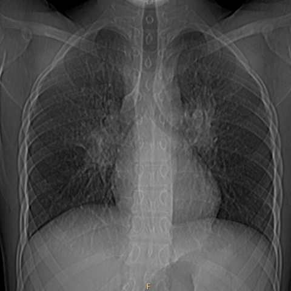

# M1独立训练种子：10508_8353800725099

[原始预测/反思/规则候选](../../traces/seed/10508_8353800725099.json)

来源：[ChestAgentBench固定版本](https://huggingface.co/datasets/wanglab/chest-agent-bench/tree/921e60440927f9893228d843c0206b755744252a) · [Eurorad病例](https://www.eurorad.org/case/10508)。数字前缀只用于来源链接，病例排除仍使用显式case_id派生hash。

本例属于独立memory_train，未与评测病例共享case_hash。原参考标签只用于授权的训练预热；模型影像观察仍未独立验证。

```text
Based on the chest X-ray findings in Figure 1, which of the following conclusions can be drawn regarding the presence and comparison of hilar opacifications, and how does this support a diagnosis of Behçet’s disease?
A) Bilateral hilar enlargement is present, with the right hilum significantly larger than the left, suggesting pulmonary hypertension.
B) Bilateral hilar enlargement is present, with the left hilum significantly larger than the right, supporting the suspicion of pulmonary artery aneurysms consistent with Behçet’s disease.
C) Unilateral hilar enlargement is present on the right side, suggesting a localized infection or malignancy.
D) Unilateral hilar enlargement is present on the left side, indicating possible tuberculosis.
E) No significant hilar enlargement is present, ruling out Behçet’s disease as a diagnosis.
F) Bilateral hilar enlargement is present, both hila appear equal in size, which does not support any specific diagnosis.
```



参考选项全文：Bilateral hilar enlargement is present, with the left hilum significantly larger than the right, supporting the suspicion of pulmonary artery aneurysms consistent with Behçet’s disease.

原历史只保留合法选项，未保留完整理由；不得从反思推断当时真实思路。
