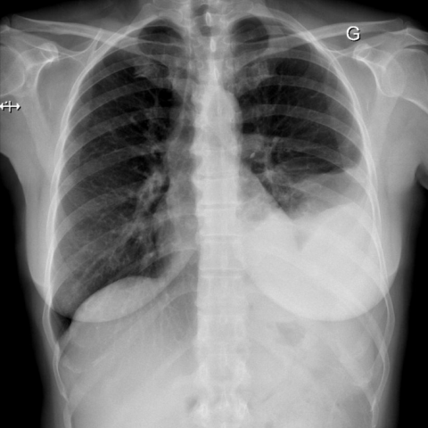

# M1独立训练种子：10514_8353800724766

[原始预测/反思/规则候选](../../traces/seed/10514_8353800724766.json)

来源：[ChestAgentBench固定版本](https://huggingface.co/datasets/wanglab/chest-agent-bench/tree/921e60440927f9893228d843c0206b755744252a) · [Eurorad病例](https://www.eurorad.org/case/10514)。数字前缀只用于来源链接，病例排除仍使用显式case_id派生hash。

本例属于独立memory_train，未与评测病例共享case_hash。原参考标签只用于授权的训练预热；模型影像观察仍未独立验证。

```text
Based on the chest X-ray findings, what can be inferred about the location and characteristics of the thoracic lesion in the patient? 
A) The opacity is located at the left lung apex and is consistent with a pleural effusion.
B) The opacity is located at the left lung base and demonstrates characteristics of a mass with a broad pleural base.
C) The opacity is centrally located in the left lung and is consistent with a lymph node enlargement.
D) The opacity is located in the right lower lobe and shows evidence of diaphragmatic involvement.
E) The opacity is located in the left lung base, extending into the oblique fissure, and is suggestive of a mass with calcifications.
F) The opacity is in the right lung base and shows a homogeneous appearance.
```



参考选项全文：The opacity is located at the left lung base and demonstrates characteristics of a mass with a broad pleural base.

原历史只保留合法选项，未保留完整理由；不得从反思推断当时真实思路。
