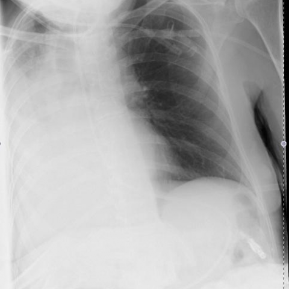
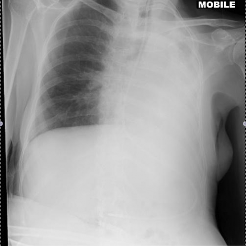
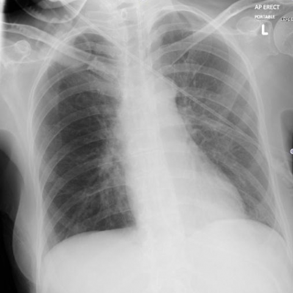

# M1独立训练种子：10515_8353800724799

[原始预测/反思/规则候选](../../traces/seed/10515_8353800724799.json)

来源：[ChestAgentBench固定版本](https://huggingface.co/datasets/wanglab/chest-agent-bench/tree/921e60440927f9893228d843c0206b755744252a) · [Eurorad病例](https://www.eurorad.org/case/10515)。数字前缀只用于来源链接，病例排除仍使用显式case_id派生hash。

本例属于独立memory_train，未与评测病例共享case_hash。原参考标签只用于授权的训练预热；模型影像观察仍未独立验证。

```text
Based on the chest X-rays provided, which of the following options best describes the sequence of changes observed, and what is the most likely underlying cause of these radiographic findings?  
A) Figure 1 shows right-sided pleural effusion, resolved by Figure 2, with subsequent left-sided pleural effusion in Figure 2 due to congestive heart failure.  
B) Figure 1 shows dense right-sided consolidation and collapse that resolves by Figure 2, where there is now complete opacification of the left hemithorax, most likely due to mucous plugging.  
C) Figure 1 shows right-sided pneumothorax, resolved by Figure 2, followed by left-sided atelectasis in Figure 2 due to aspiration pneumonia.  
D) Figure 1 shows bilateral pulmonary edema, resolved by Figure 2, with new right-sided pneumonia in Figure 2 due to bacterial infection.  
E) Figure 1 shows right-sided consolidation and collapse that resolves by Figure 2, with new left-sided pneumothorax in Figure 2 due to mechanical ventilation.  
F) Figure 1 shows left-sided consolidation and collapse that resolves by Figure 2, with new right-sided opacification in Figure 2 due to pleural effusion.
```







参考选项全文：Figure 1 shows dense right-sided consolidation and collapse that resolves by Figure 2, where there is now complete opacification of the left hemithorax, most likely due to mucous plugging.

