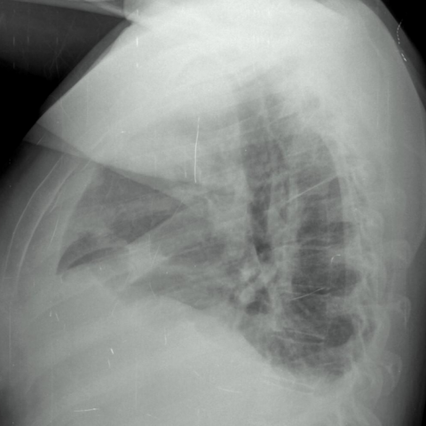
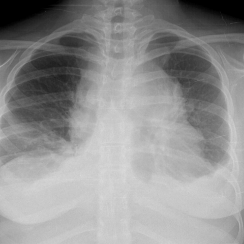

# M1独立训练种子：10547_8353800725075

[原始预测/反思/规则候选](../../traces/seed/10547_8353800725075.json)

来源：[ChestAgentBench固定版本](https://huggingface.co/datasets/wanglab/chest-agent-bench/tree/921e60440927f9893228d843c0206b755744252a) · [Eurorad病例](https://www.eurorad.org/case/10547)。数字前缀只用于来源链接，病例排除仍使用显式case_id派生hash。

本例属于独立memory_train，未与评测病例共享case_hash。原参考标签只用于授权的训练预热；模型影像观察仍未独立验证。

```text
Based on the chest X-ray images provided, which of the following statements is most accurate regarding the mediastinal mass and pleural effusions observed in this patient?
A) The mediastinal mass is predominantly located on the right side and the pleural effusion is more pronounced on the left side.
B) The mediastinal mass is located centrally with equal pleural effusions on both sides.
C) The mediastinal mass is predominantly located on the left side, and the pleural effusion is more pronounced on the right side.
D) The mediastinal mass is predominantly located on the right side and the pleural effusion is more pronounced on the right side.
E) The mediastinal mass is predominantly located on the left side with equal pleural effusions on both sides.
F) The mediastinal mass is located centrally, with pleural effusions more pronounced on the left side.
```





参考选项全文：The mediastinal mass is predominantly located on the left side, and the pleural effusion is more pronounced on the right side.

