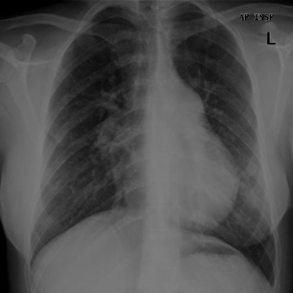
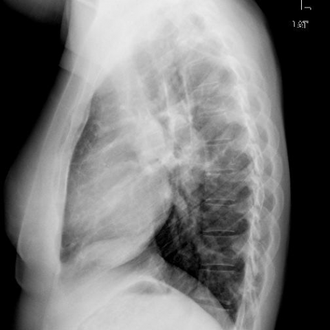

# M1独立训练种子：10565_8353800724709

[原始预测/反思/规则候选](../../traces/seed/10565_8353800724709.json)

来源：[ChestAgentBench固定版本](https://huggingface.co/datasets/wanglab/chest-agent-bench/tree/921e60440927f9893228d843c0206b755744252a) · [Eurorad病例](https://www.eurorad.org/case/10565)。数字前缀只用于来源链接，病例排除仍使用显式case_id派生hash。

本例属于独立memory_train，未与评测病例共享case_hash。原参考标签只用于授权的训练预热；模型影像观察仍未独立验证。

```text
Based on the chest X-ray findings in Figure 3, which of the following is the most likely explanation for the patient's symptoms of progressive dyspnea and cough? 
A) Pulmonary edema due to left-sided heart failure, as indicated by enlarged pulmonary arteries and interstitial markings.
B) Pulmonary hypertension secondary to sarcoidosis, suggested by enlarged pulmonary arteries and right ventricular hypertrophy.
C) Chronic obstructive pulmonary disease, inferred from hyperinflated lungs and flattened diaphragm.
D) Pneumonia, as evidenced by patchy infiltrates and consolidation in the lower lobes.
E) Pleural effusion, indicated by blunting of the costophrenic angles and fluid levels.
F) Primary lung cancer, suggested by a large mass in the right lung field and lymphadenopathy.
```





参考选项全文：Pulmonary hypertension secondary to sarcoidosis, suggested by enlarged pulmonary arteries and right ventricular hypertrophy.

