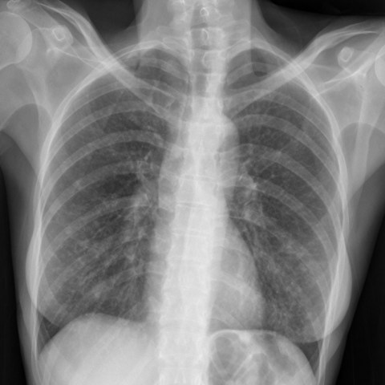
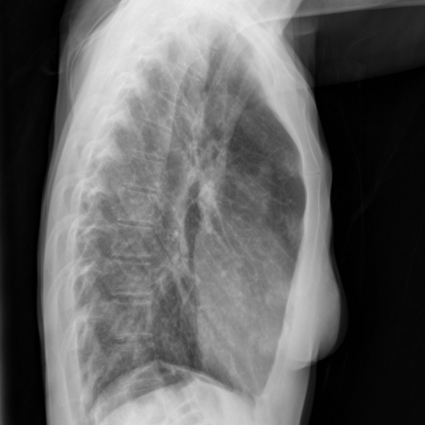

# M1独立训练种子：10572_8353800724658

[原始预测/反思/规则候选](../../traces/seed/10572_8353800724658.json)

来源：[ChestAgentBench固定版本](https://huggingface.co/datasets/wanglab/chest-agent-bench/tree/921e60440927f9893228d843c0206b755744252a) · [Eurorad病例](https://www.eurorad.org/case/10572)。数字前缀只用于来源链接，病例排除仍使用显式case_id派生hash。

本例属于独立memory_train，未与评测病例共享case_hash。原参考标签只用于授权的训练预热；模型影像观察仍未独立验证。

```text
Based on the chest X-rays (Figures 1a and 1b), which of the following statements best supports the diagnosis of diffuse idiopathic pulmonary neuroendocrine cell hyperplasia (DIPNECH) in this patient?
A) The chest X-rays show bilateral nodular densities with associated volume loss, indicative of a possible infectious process.
B) The chest X-rays show bilateral nodular densities without accompanying volume loss, consistent with DIPNECH.
C) The chest X-rays show unilateral nodular densities, which are characteristic of DIPNECH.
D) The chest X-rays reveal bilateral nodular densities with cavitation, suggesting a differential diagnosis of pulmonary infection.
E) The chest X-rays demonstrate bilateral nodular densities with extensive ground-glass opacities, pointing towards metastatic disease.
F) The chest X-rays show isolated large nodules, which are typical of DIPNECH.
```





参考选项全文：The chest X-rays show bilateral nodular densities without accompanying volume loss, consistent with DIPNECH.

