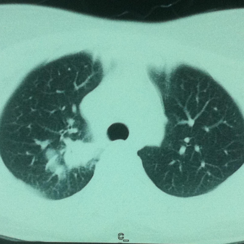

# M1独立训练种子：10608_8353800735751

[原始预测/反思/规则候选](../../traces/seed/10608_8353800735751.json)

来源：[ChestAgentBench固定版本](https://huggingface.co/datasets/wanglab/chest-agent-bench/tree/921e60440927f9893228d843c0206b755744252a) · [Eurorad病例](https://www.eurorad.org/case/10608)。数字前缀只用于来源链接，病例排除仍使用显式case_id派生hash。

本例属于独立memory_train，未与评测病例共享case_hash。原参考标签只用于授权的训练预热；模型影像观察仍未独立验证。

```text
Based on the chest X-ray findings, which of the following statements correctly describes the relationship and characteristics of the right upper lobe opacity in the context of the patient's presentation?

A) The right upper lobe opacity is smaller in size than the corresponding left upper lobe area and shows no signs of contact with adjacent structures.
B) The right upper lobe opacity is larger than the corresponding left upper lobe area and demonstrates clear spiculated borders, suggesting a benign process.
C) The right upper lobe opacity is in contact with the mediastinum and vertebra, which, in conjunction with its spiculated borders, suggests a malignancy-like appearance.
D) The right upper lobe opacity is isolated without any nodular satellite lesions, indicating a localized inflammatory process.
E) The right upper lobe opacity shows signs of cavitation and is located centrally, away from the mediastinum.
F) The right upper lobe opacity does not show any contact with the mediastinum but has multiple calcifications, which suggests a chronic inflammatory process.
```



参考选项全文：The right upper lobe opacity is in contact with the mediastinum and vertebra, which, in conjunction with its spiculated borders, suggests a malignancy-like appearance.

原历史只保留合法选项，未保留完整理由；不得从反思推断当时真实思路。
