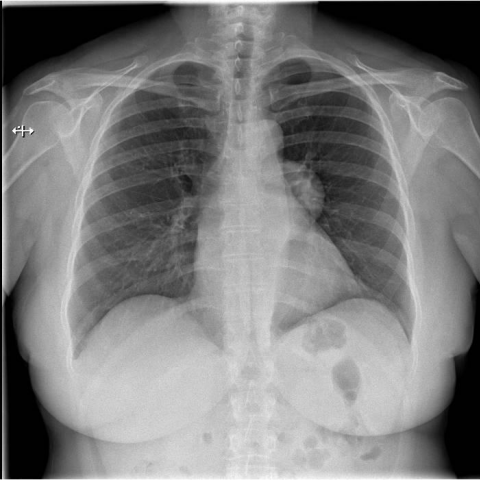
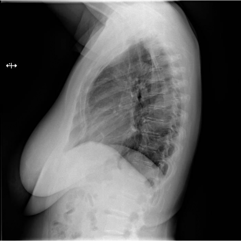

# M1独立训练种子：10610_8353800724514

[原始预测/反思/规则候选](../../traces/seed/10610_8353800724514.json)

来源：[ChestAgentBench固定版本](https://huggingface.co/datasets/wanglab/chest-agent-bench/tree/921e60440927f9893228d843c0206b755744252a) · [Eurorad病例](https://www.eurorad.org/case/10610)。数字前缀只用于来源链接，病例排除仍使用显式case_id派生hash。

本例属于独立memory_train，未与评测病例共享case_hash。原参考标签只用于授权的训练预热；模型影像观察仍未独立验证。

```text
Based on the chest X-ray findings, what is the most likely characterization and diagnosis of the mass identified in the left hemithorax of this 58-year-old woman undergoing a presurgical evaluation?  
A. A sharply marginated mass with acute angles indicative of a pulmonary origin, suggesting a bronchogenic cyst.  
B. A smoothly marginated mass with obtuse angles suggesting an extrapulmonary origin, consistent with a benign schwannoma.  
C. A poorly defined mass with irregular margins consistent with a malignancy.  
D. A mass with rib erosion indicating a malignant process.  
E. A well-circumscribed mass with calcifications consistent with a teratoma.  
F. A diffusely infiltrative mass consistent with lymphoma.
```





参考选项全文：A smoothly marginated mass with obtuse angles suggesting an extrapulmonary origin, consistent with a benign schwannoma.

