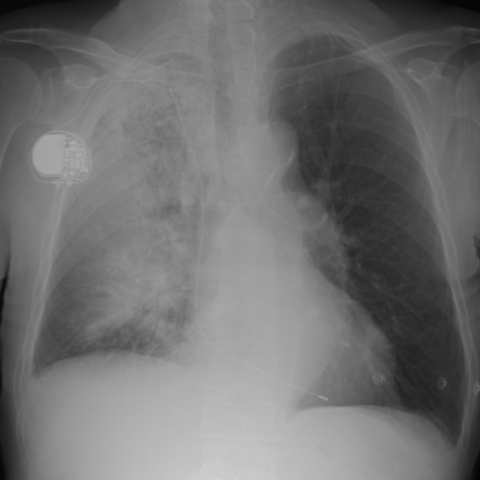
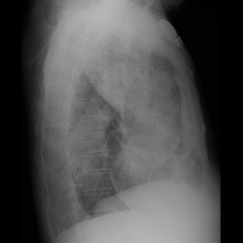

# M1独立训练种子：10665_8353800735763

[原始预测/反思/规则候选](../../traces/seed/10665_8353800735763.json)

来源：[ChestAgentBench固定版本](https://huggingface.co/datasets/wanglab/chest-agent-bench/tree/921e60440927f9893228d843c0206b755744252a) · [Eurorad病例](https://www.eurorad.org/case/10665)。数字前缀只用于来源链接，病例排除仍使用显式case_id派生hash。

本例属于独立memory_train，未与评测病例共享case_hash。原参考标签只用于授权的训练预热；模型影像观察仍未独立验证。

```text
Based on the chest radiograph findings, what is the most likely explanation for the right-sided respiratory abnormalities observed in this patient, considering the distribution of opacification and pleural effusion? 

A) There is extensive consolidation confined only to the right upper lobe, with pleural effusion causing mediastinal shift.  
B) The right middle lobe is the primary site of consolidation, with a small pleural effusion contributing to respiratory symptoms.  
C) Consolidation in the right upper, middle, and lower lobes is causing air bronchograms, with a small pleural effusion also present.  
D) The right lower lobe shows ground-glass opacities, with extensive pleural effusion leading to lobar collapse.  
E) A large pleural effusion in the right hemithorax is causing contralateral tracheal deviation, with minimal consolidation.  
F) There is bilateral lung involvement with extensive consolidation in both lungs, causing respiratory distress.
```





参考选项全文：Consolidation in the right upper, middle, and lower lobes is causing air bronchograms, with a small pleural effusion also present.

