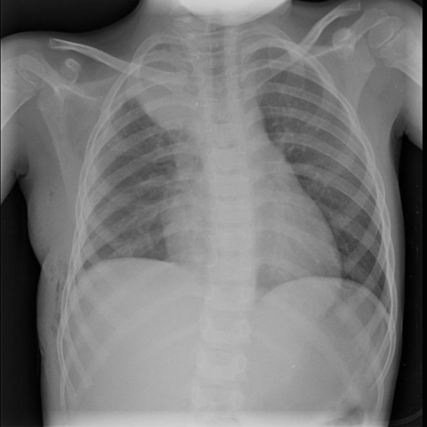

# M1独立训练种子：10822_8353800724955

[原始预测/反思/规则候选](../../traces/seed/10822_8353800724955.json)

来源：[ChestAgentBench固定版本](https://huggingface.co/datasets/wanglab/chest-agent-bench/tree/921e60440927f9893228d843c0206b755744252a) · [Eurorad病例](https://www.eurorad.org/case/10822)。数字前缀只用于来源链接，病例排除仍使用显式case_id派生hash。

本例属于独立memory_train，未与评测病例共享case_hash。原参考标签只用于授权的训练预热；模型影像观察仍未独立验证。

```text
Based on Figure 5, which of the following findings would indicate a possible recurrence of ganglioneuroblastoma in the right subclavicular fossa?  
A) Presence of a new paravertebral mass with calcifications  
B) Clear lung fields with no new mass  
C) Increased pleural effusion on the right side  
D) Right-sided costal excision with no mass  
E) New mass in the left subclavicular fossa  
F) Diffuse bilateral lung infiltrates
```



参考选项全文：Presence of a new paravertebral mass with calcifications

原历史只保留合法选项，未保留完整理由；不得从反思推断当时真实思路。
