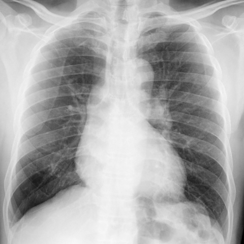

# M1独立训练种子：10966_8353800724625

[原始预测/反思/规则候选](../../traces/seed/10966_8353800724625.json)

来源：[ChestAgentBench固定版本](https://huggingface.co/datasets/wanglab/chest-agent-bench/tree/921e60440927f9893228d843c0206b755744252a) · [Eurorad病例](https://www.eurorad.org/case/10966)。数字前缀只用于来源链接，病例排除仍使用显式case_id派生hash。

本例属于独立memory_train，未与评测病例共享case_hash。原参考标签只用于授权的训练预热；模型影像观察仍未独立验证。

```text
Based on Figure 1, which of the following findings most strongly supports the diagnosis of Swyer-James-MacLeod Syndrome in the patient?

A) Increased size of the right pulmonary hilum and symmetrical lung vasculature.
B) Decreased size of the right pulmonary hilum and asymmetry of the lung vasculature, with lower vascular markings on the right side.
C) Increased volume of the right lung with compensatory left lung volume reduction.
D) Normal pulmonary hilum size with equal vascular markings on both sides.
E) Increased vascular markings in the right lung with decreased size of the left pulmonary hilum.
F) Decreased size of the left pulmonary hilum and asymmetry of the lung vasculature, with lower vascular markings on the left side.
```



参考选项全文：Decreased size of the right pulmonary hilum and asymmetry of the lung vasculature, with lower vascular markings on the right side.

原历史只保留合法选项，未保留完整理由；不得从反思推断当时真实思路。
