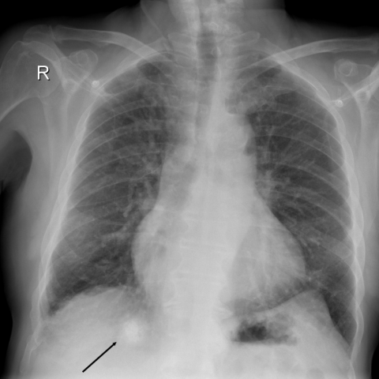

# M1独立训练种子：11099_8353800736117

[原始预测/反思/规则候选](../../traces/seed/11099_8353800736117.json)

来源：[ChestAgentBench固定版本](https://huggingface.co/datasets/wanglab/chest-agent-bench/tree/921e60440927f9893228d843c0206b755744252a) · [Eurorad病例](https://www.eurorad.org/case/11099)。数字前缀只用于来源链接，病例排除仍使用显式case_id派生hash。

本例属于独立memory_train，未与评测病例共享case_hash。原参考标签只用于授权的训练预热；模型影像观察仍未独立验证。

```text
Based on the chest X-ray findings from admission, which of the following is the most appropriate characterization of the right basal mass lesion observed in Figure 1, considering the patient's clinical presentation and history? 

A) A sharply demarcated, calcified mass likely representing a benign granuloma, correlating with the patient's asymptomatic thoracic venous anomaly.
B) A poorly defined, non-calcified mass consistent with a malignant neoplasm, necessitating further immediate oncological evaluation.
C) A smoothly contoured, calcified lesion suggesting a benign granuloma, incidental to the patient's acute neurological symptoms.
D) An irregularly margined, dense lesion indicating possible infectious etiology requiring further microbiological investigation.
E) A homogeneously dense, sharply outlined mass consistent with a vascular anomaly linked to the patient's congenital heart defect history.
F) A well-circumscribed, non-calcified mass likely representing a chronic inflammatory process, unrelated to the patient's acute symptoms.
```



参考选项全文：A smoothly contoured, calcified lesion suggesting a benign granuloma, incidental to the patient's acute neurological symptoms.

原历史只保留合法选项，未保留完整理由；不得从反思推断当时真实思路。
