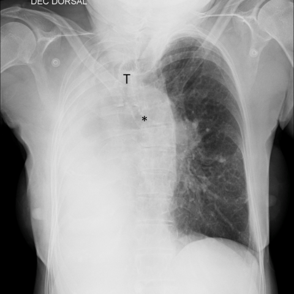

# M1独立训练种子：11286_8353800725444

[原始预测/反思/规则候选](../../traces/seed/11286_8353800725444.json)

来源：[ChestAgentBench固定版本](https://huggingface.co/datasets/wanglab/chest-agent-bench/tree/921e60440927f9893228d843c0206b755744252a) · [Eurorad病例](https://www.eurorad.org/case/11286)。数字前缀只用于来源链接，病例排除仍使用显式case_id派生hash。

本例属于独立memory_train，未与评测病例共享case_hash。原参考标签只用于授权的训练预热；模型影像观察仍未独立验证。

```text
Based on the chest X-ray findings, which of the following is the most likely diagnosis for this 73-year-old woman with absence of breath sounds in the right hemithorax and mediastinal shift? Consider the presence of opacification, mediastinal shift, and absence of bronchial structures in your reasoning.
A) Total atelectasis of the right lung
B) Right-sided pneumonectomy
C) Unilateral pulmonary agenesis
D) Severe bronchiectasis with collapse
E) Right lung infection/pneumonia
F) Diaphragmatic hernia
```



参考选项全文：Unilateral pulmonary agenesis

原历史只保留合法选项，未保留完整理由；不得从反思推断当时真实思路。
