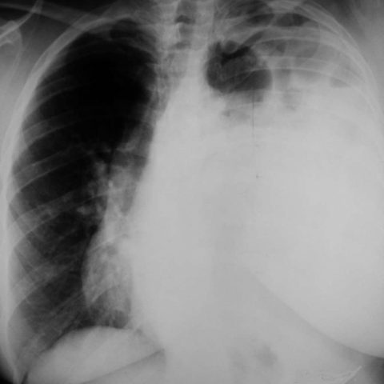

# M1独立训练种子：11306_8353800725015

[原始预测/反思/规则候选](../../traces/seed/11306_8353800725015.json)

来源：[ChestAgentBench固定版本](https://huggingface.co/datasets/wanglab/chest-agent-bench/tree/921e60440927f9893228d843c0206b755744252a) · [Eurorad病例](https://www.eurorad.org/case/11306)。数字前缀只用于来源链接，病例排除仍使用显式case_id派生hash。

本例属于独立memory_train，未与评测病例共享case_hash。原参考标签只用于授权的训练预热；模型影像观察仍未独立验证。

```text
Based on the chest X-ray findings in Figure 1, which of the following best describes the relationship and implications of the identified findings in the left hemithorax regarding the mediastinal position and lung development?

A) The left hemithorax shows an increased radiolucency with a leftward mediastinal shift, suggesting compensatory hyperinflation of the left lung and absence of abdominal organs.
B) The left hemithorax appears radiopaque with a rightward mediastinal shift, indicating the presence of abdominal organs and compression of the left lung, consistent with hypoplasia.
C) The left hemithorax has normal radiolucency with central mediastinum, suggesting normal lung development but possible pleural effusion.
D) The left hemithorax displays a reduced radiopacity and the mediastinum is central, indicating normal lung volume with no displacement of abdominal organs.
E) The left hemithorax is radiopaque with a leftward mediastinal shift, indicating absence of abdominal organs and compensatory enlargement of the left lung.
F) The left hemithorax shows increased radiolucency with a rightward mediastinal shift, suggesting compensatory hyperinflation of the right lung and possible presence of a pleural mass.
```



参考选项全文：The left hemithorax appears radiopaque with a rightward mediastinal shift, indicating the presence of abdominal organs and compression of the left lung, consistent with hypoplasia.

原历史只保留合法选项，未保留完整理由；不得从反思推断当时真实思路。
