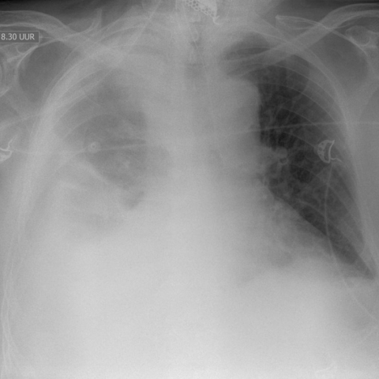
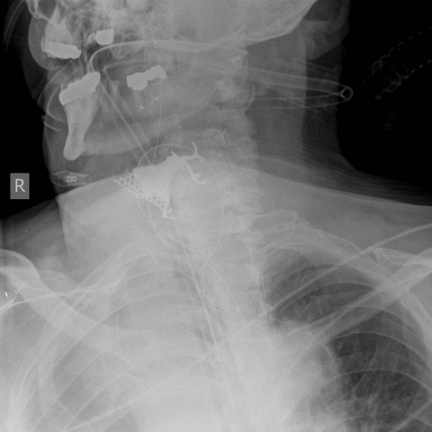

# M1独立训练种子：11340_8353800736132

[原始预测/反思/规则候选](../../traces/seed/11340_8353800736132.json)

来源：[ChestAgentBench固定版本](https://huggingface.co/datasets/wanglab/chest-agent-bench/tree/921e60440927f9893228d843c0206b755744252a) · [Eurorad病例](https://www.eurorad.org/case/11340)。数字前缀只用于来源链接，病例排除仍使用显式case_id派生hash。

本例属于独立memory_train，未与评测病例共享case_hash。原参考标签只用于授权的训练预热；模型影像观察仍未独立验证。

```text
Based on the chest X-ray observations, which of the following findings most likely contributed to the difficult tracheal intubation in this patient?

A) Right pleural effusion leading to lung volume loss.
B) Increased perihilar vascular markings bilaterally.
C) A foreign body located in the oropharynx prior to intubation.
D) Accentuated right perihilar vasculature.
E) Lower lobe atelectasis on the right side.
F) Correct endotracheal tube placement post-intubation.
```





参考选项全文：A foreign body located in the oropharynx prior to intubation.

