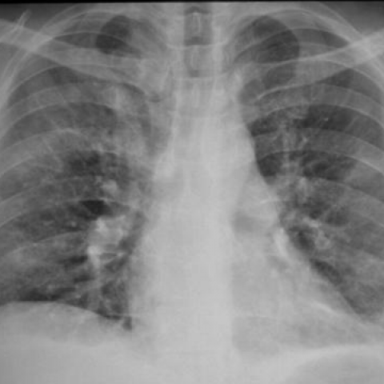

# M1独立训练种子：11384_8353800736210

[原始预测/反思/规则候选](../../traces/seed/11384_8353800736210.json)

来源：[ChestAgentBench固定版本](https://huggingface.co/datasets/wanglab/chest-agent-bench/tree/921e60440927f9893228d843c0206b755744252a) · [Eurorad病例](https://www.eurorad.org/case/11384)。数字前缀只用于来源链接，病例排除仍使用显式case_id派生hash。

本例属于独立memory_train，未与评测病例共享case_hash。原参考标签只用于授权的训练预热；模型影像观察仍未独立验证。

```text
Based on the chest X-ray findings in Figure 1, what is the most likely characteristic of the identified pulmonary opacities, and how do these findings correlate with Idiopathic Hypereosinophilic Syndrome (IHS)?  
A) The opacities are well-defined with peripheral ground-glass halos, suggesting an infectious process typically seen in conditions like invasive aspergillosis.  
B) The opacities are ill-defined with diffuse distribution, consistent with eosinophilic infiltration, which aligns with pulmonary involvement in IHS.  
C) The opacities are well-circumscribed nodules, indicating a neoplastic process such as bronchioloalveolar carcinoma.  
D) The opacities are sharply marginated and localized to the lower lobes, consistent with pulmonary embolism.  
E) The opacities are accompanied by pleural effusion, which is common in IHS, suggesting an advanced stage of the disease.  
F) The opacities are confluent with lobar distribution, indicative of bacterial pneumonia.
```



参考选项全文：The opacities are ill-defined with diffuse distribution, consistent with eosinophilic infiltration, which aligns with pulmonary involvement in IHS.

原历史只保留合法选项，未保留完整理由；不得从反思推断当时真实思路。
