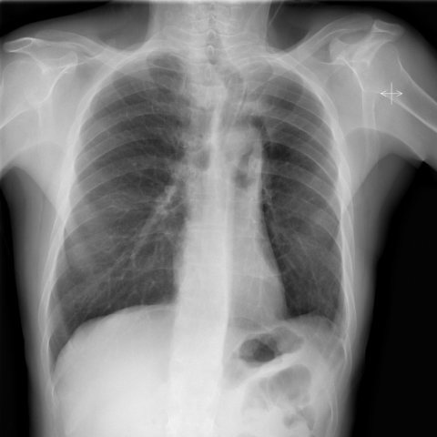

# M1独立训练种子：11402_8353800750213

[原始预测/反思/规则候选](../../traces/seed/11402_8353800750213.json)

来源：[ChestAgentBench固定版本](https://huggingface.co/datasets/wanglab/chest-agent-bench/tree/921e60440927f9893228d843c0206b755744252a) · [Eurorad病例](https://www.eurorad.org/case/11402)。数字前缀只用于来源链接，病例排除仍使用显式case_id派生hash。

本例属于独立memory_train，未与评测病例共享case_hash。原参考标签只用于授权的训练预热；模型影像观察仍未独立验证。

```text
Based on the chest X-ray findings in Figure 5, which statement best describes the postoperative status of the patient’s tracheal condition?
A) The tracheal stent is correctly placed, with no evidence of mediastinal shift.
B) The tracheal stent is misplaced, causing complete tracheal obstruction.
C) The tracheal stent is correctly placed, with leftward mediastinal shift due to prior lobectomy.
D) There is residual thickening of the tracheal wall without stent placement.
E) The mediastinal structures are shifted to the right, indicating incorrect stent placement.
F) The chest X-ray shows evidence of pulmonary metastasis.
```



参考选项全文：The tracheal stent is correctly placed, with leftward mediastinal shift due to prior lobectomy.

原历史只保留合法选项，未保留完整理由；不得从反思推断当时真实思路。
