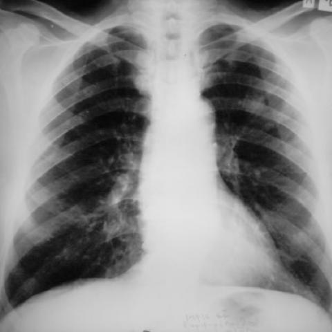
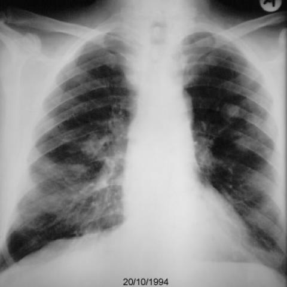
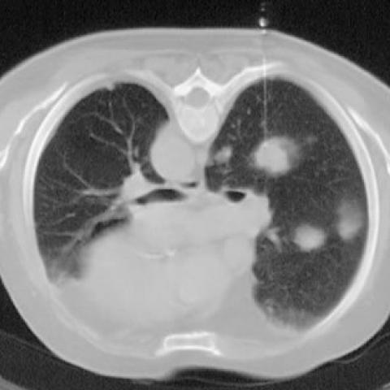
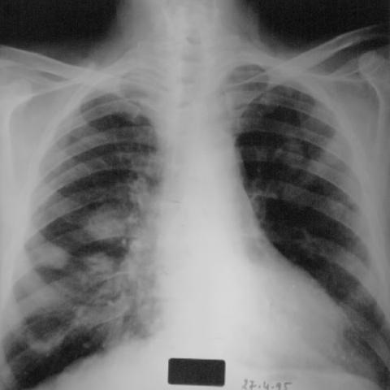
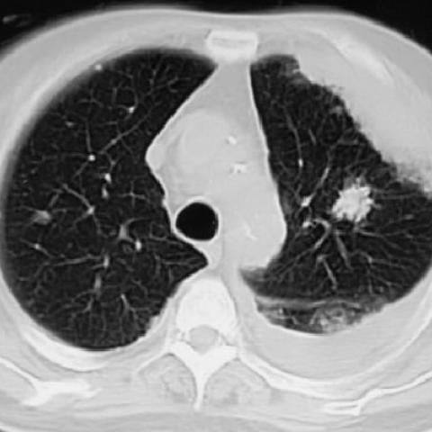
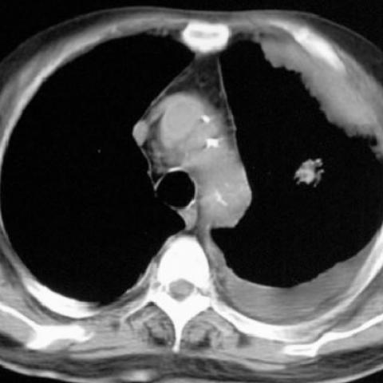
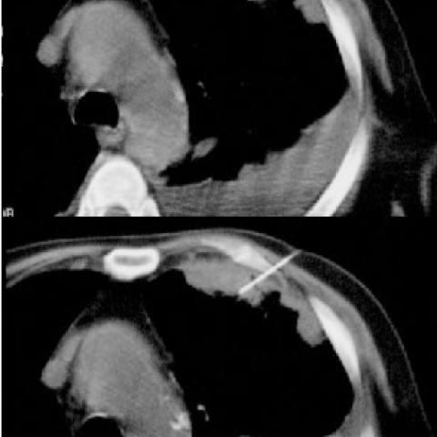
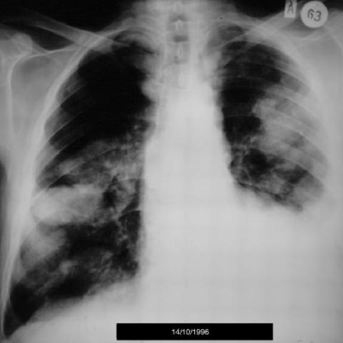
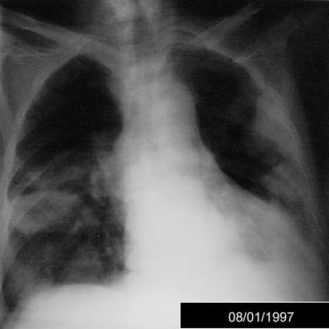

# M1独立训练种子：1147_8353802117655

[原始预测/反思/规则候选](../../traces/seed/1147_8353802117655.json)

来源：[ChestAgentBench固定版本](https://huggingface.co/datasets/wanglab/chest-agent-bench/tree/921e60440927f9893228d843c0206b755744252a) · [Eurorad病例](https://www.eurorad.org/case/1147)。数字前缀只用于来源链接，病例排除仍使用显式case_id派生hash。

本例属于独立memory_train，未与评测病例共享case_hash。原参考标签只用于授权的训练预热；模型影像观察仍未独立验证。

```text
Based on the chest X-ray figures, which of the following best describes the progression and characteristics of the pulmonary findings over the observed period, considering the diagnosis of primary pulmonary nodular amyloidosis?
A) A solitary nodule above the left hilus with no evidence of progression or pleural involvement.
B) Bilateral nodules with increase in number and size on the right side, accompanied by a transient left pleural effusion.
C) Right lung nodules decreasing in size with a persistent large left pleural effusion.
D) Predominantly left-sided nodules with significant calcification and no pleural effusion.
E) Significant progression of nodules in both lungs with a consistent right-sided pleural effusion.
F) Decrease in number of nodules over time with no pleural effusion or significant lung changes.
```



















参考选项全文：Bilateral nodules with increase in number and size on the right side, accompanied by a transient left pleural effusion.

