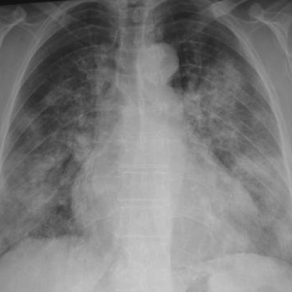
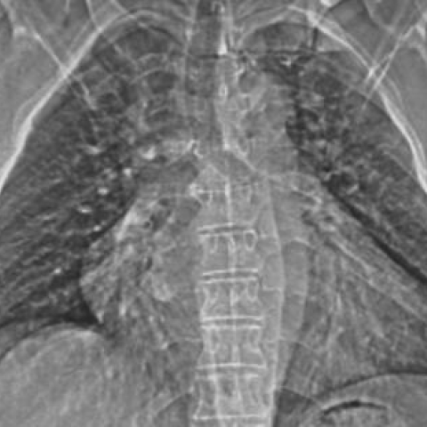

# M1独立训练种子：11513_8353800750294

[原始预测/反思/规则候选](../../traces/seed/11513_8353800750294.json)

来源：[ChestAgentBench固定版本](https://huggingface.co/datasets/wanglab/chest-agent-bench/tree/921e60440927f9893228d843c0206b755744252a) · [Eurorad病例](https://www.eurorad.org/case/11513)。数字前缀只用于来源链接，病例排除仍使用显式case_id派生hash。

本例属于独立memory_train，未与评测病例共享case_hash。原参考标签只用于授权的训练预热；模型影像观察仍未独立验证。

```text
A 57-year-old female patient with a history of haemoptysis, chest pain, and dyspnoea underwent a chest X-ray examination. The chest radiograph (Figure 1) shows bilateral, symmetric, coarse nodular opacities throughout the lungs. Considering the clinical context and the imaging findings, what is the most likely diagnosis and what change should be observed in the follow-up chest X-ray (Figure 3) after treatment with intravenous steroids?

A) The diagnosis is primary antiphospholipid syndrome affecting the lung. The follow-up chest X-ray should show resolution of the bilateral, symmetric opacities.
B) The diagnosis is Wegener granulomatosis. The follow-up chest X-ray should show persistence of the bilateral, symmetric opacities.
C) The diagnosis is Goodpasture’s syndrome. The follow-up chest X-ray should show new areas of consolidation.
D) The diagnosis is primary antiphospholipid syndrome affecting the lung. The follow-up chest X-ray should show no change in the opacities.
E) The diagnosis is pulmonary embolism. The follow-up chest X-ray should show resolution of the bilateral, symmetric opacities.
F) The diagnosis is pneumonia. The follow-up chest X-ray should show increased opacification.
```





参考选项全文：The diagnosis is primary antiphospholipid syndrome affecting the lung. The follow-up chest X-ray should show resolution of the bilateral, symmetric opacities.

