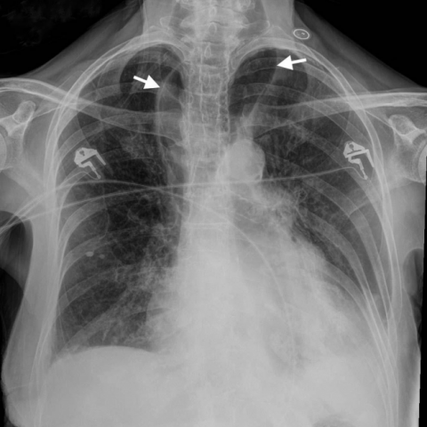
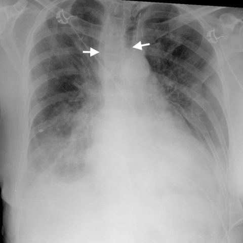

# M1独立训练种子：11527_8353800763411

[原始预测/反思/规则候选](../../traces/seed/11527_8353800763411.json)

来源：[ChestAgentBench固定版本](https://huggingface.co/datasets/wanglab/chest-agent-bench/tree/921e60440927f9893228d843c0206b755744252a) · [Eurorad病例](https://www.eurorad.org/case/11527)。数字前缀只用于来源链接，病例排除仍使用显式case_id派生hash。

本例属于独立memory_train，未与评测病例共享case_hash。原参考标签只用于授权的训练预热；模型影像观察仍未独立验证。

```text
In the chest X-ray findings of this 89-year-old female patient with acute dyspnoea and other symptoms, which of the following best describes the changes observed in the mediastinum between the present (Fig 1a) and two years prior (Fig 1b), and the implications for adjacent thoracic structures?

A) The mediastinum has significantly narrowed over time, indicating resolution of the oesophageal dilatation, which has relieved pressure on the trachea.
B) The mediastinum has remained the same size, suggesting no progression of the oesophageal condition, and the trachea maintains its normal position.
C) The mediastinum has widened significantly compared to two years ago due to increased oesophageal dilatation, displacing the trachea anteriorly.
D) The mediastinum has narrowed slightly, indicating partial improvement in oesophageal motility, with the trachea remaining midline.
E) The mediastinum has widened slightly, but the trachea remains in its original position, suggesting stable oesophageal dilatation.
F) The mediastinum has widened significantly, compressing the trachea posteriorly, which correlates with worsening dyspnoea.
```





参考选项全文：The mediastinum has widened significantly compared to two years ago due to increased oesophageal dilatation, displacing the trachea anteriorly.

