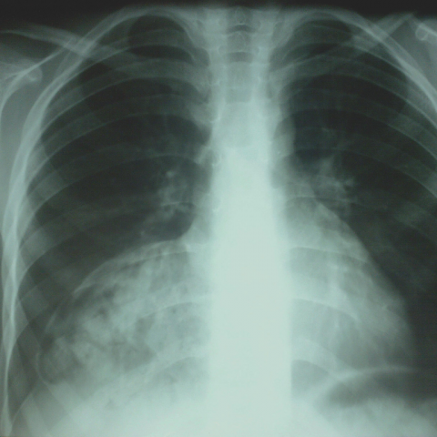

# M1独立训练种子：11580_8353800750504

[原始预测/反思/规则候选](../../traces/seed/11580_8353800750504.json)

来源：[ChestAgentBench固定版本](https://huggingface.co/datasets/wanglab/chest-agent-bench/tree/921e60440927f9893228d843c0206b755744252a) · [Eurorad病例](https://www.eurorad.org/case/11580)。数字前缀只用于来源链接，病例排除仍使用显式case_id派生hash。

本例属于独立memory_train，未与评测病例共享case_hash。原参考标签只用于授权的训练预热；模型影像观察仍未独立验证。

```text
Based on the chest X-ray in Figure 1, identify the location and characteristics of the mass observed. How does the position and size of this mass compare to typical diaphragmatic hernias, and what is the likely diagnosis? Consider the following options:
A) The mass is located in the left cardiophrenic angle, is small, and suggests a Bochdalek hernia.
B) The mass is located in the right cardiophrenic angle, is large, and suggests a Morgagni hernia.
C) The mass is located in the right cardiophrenic angle, is small, and suggests a pericardial cyst.
D) The mass is located in the right cardiophrenic angle, is large, and suggests a hiatal hernia.
E) The mass is located in the left cardiophrenic angle, is large, and suggests a Morgagni hernia.
F) The mass is located in the left cardiophrenic angle, is small, and suggests an anterior mediastinal mass.
```



参考选项全文：The mass is located in the right cardiophrenic angle, is large, and suggests a Morgagni hernia.

原历史只保留合法选项，未保留完整理由；不得从反思推断当时真实思路。
