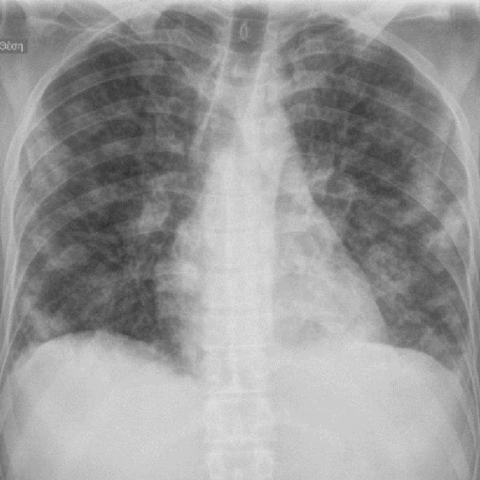

# M1独立训练种子：11583_8353800736258

[原始预测/反思/规则候选](../../traces/seed/11583_8353800736258.json)

来源：[ChestAgentBench固定版本](https://huggingface.co/datasets/wanglab/chest-agent-bench/tree/921e60440927f9893228d843c0206b755744252a) · [Eurorad病例](https://www.eurorad.org/case/11583)。数字前缀只用于来源链接，病例排除仍使用显式case_id派生hash。

本例属于独立memory_train，未与评测病例共享case_hash。原参考标签只用于授权的训练预热；模型影像观察仍未独立验证。

```text
Based on the chest X-ray in Figure 1, which of the following statements accurately describes the observed pulmonary findings and their implications for the patient's condition?
A) The nodular infiltrates are predominantly in the right lung, with cavitation present only in the larger nodules.
B) The nodular infiltrates are evenly distributed across both lungs, with cavitation present in both smaller and larger nodules.
C) The nodular infiltrates are more prominent in the left lung, with cavitation seen exclusively in the left lower lobe nodules.
D) The nodular infiltrates are primarily located in the lower lobes of both lungs, and cavitation is more frequent in the nodules associated with the right lung.
E) The nodular infiltrates show a predilection for the upper lobes, and no cavitation is visible in the X-ray.
F) The nodular infiltrates are more numerous in the right lung, with cavitation present in both the right and left lung nodules.
```



参考选项全文：The nodular infiltrates are evenly distributed across both lungs, with cavitation present in both smaller and larger nodules.

原历史只保留合法选项，未保留完整理由；不得从反思推断当时真实思路。
