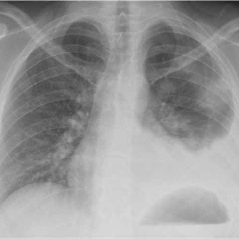
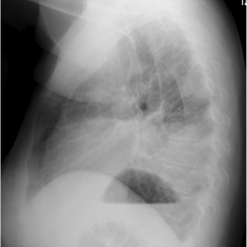

# M1独立训练种子：11613_8353800650768

[原始预测/反思/规则候选](../../traces/seed/11613_8353800650768.json)

来源：[ChestAgentBench固定版本](https://huggingface.co/datasets/wanglab/chest-agent-bench/tree/921e60440927f9893228d843c0206b755744252a) · [Eurorad病例](https://www.eurorad.org/case/11613)。数字前缀只用于来源链接，病例排除仍使用显式case_id派生hash。

本例属于独立memory_train，未与评测病例共享case_hash。原参考标签只用于授权的训练预热；模型影像观察仍未独立验证。

```text
Based on the chest X-ray findings in Figures 1a and 1b, which of the following statements best describes the observed pleural effusion and its relationship to the patchy consolidation in the left upper lobe?

A) The pleural effusion is larger than the area of patchy consolidation, and both findings are predominantly located in the anterior zone of the left lung.
B) The pleural effusion is smaller than the patchy consolidation, with the effusion localized to the lateral zone, while the consolidation is in the left upper lobe.
C) The pleural effusion and patchy consolidation overlap in the posterior zone of the left lung, with the effusion extending to the anterior zone.
D) The pleural effusion is larger than the patchy consolidation, with both findings localized to the posterior zone of the left lung.
E) The pleural effusion is smaller than the patchy consolidation, and the consolidation is located in the anterior zone of the left upper lobe.
F) The pleural effusion and patchy consolidation are independent of each other, with no overlap in their respective locations.
```





参考选项全文：The pleural effusion is larger than the patchy consolidation, with both findings localized to the posterior zone of the left lung.

