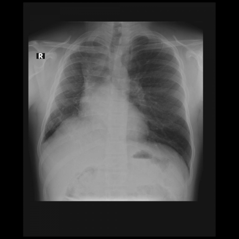
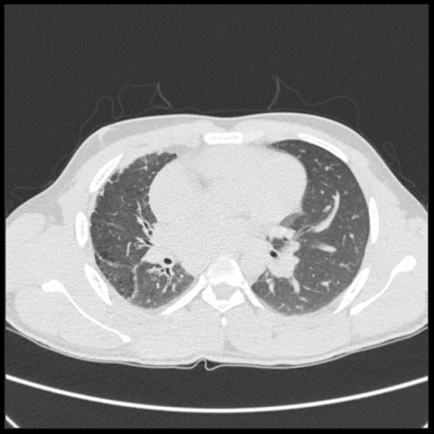
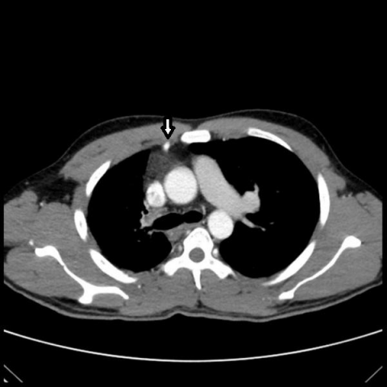

# M1独立训练种子：11675_8353800650831

[原始预测/反思/规则候选](../../traces/seed/11675_8353800650831.json)

来源：[ChestAgentBench固定版本](https://huggingface.co/datasets/wanglab/chest-agent-bench/tree/921e60440927f9893228d843c0206b755744252a) · [Eurorad病例](https://www.eurorad.org/case/11675)。数字前缀只用于来源链接，病例排除仍使用显式case_id派生hash。

本例属于独立memory_train，未与评测病例共享case_hash。原参考标签只用于授权的训练预热；模型影像观察仍未独立验证。

```text
Based on the chest X-ray findings, which of the following best explains the observed mediastinal shift and reduced right lung volume in the patient? 
A) Right pneumothorax causing collapse of the right lung.
B) Right pulmonary artery agenesis leading to reduced lung volume and compensatory hyperinflation of the left lung.
C) Right lung mass causing tracheal deviation and volume loss.
D) Right pleural effusion causing mediastinal shift and reduced lung volume.
E) Right lower lobe pneumonia causing volume loss and mediastinal shift.
F) Bilateral pulmonary embolism affecting the right lung more severely.
```







参考选项全文：Right pulmonary artery agenesis leading to reduced lung volume and compensatory hyperinflation of the left lung.

