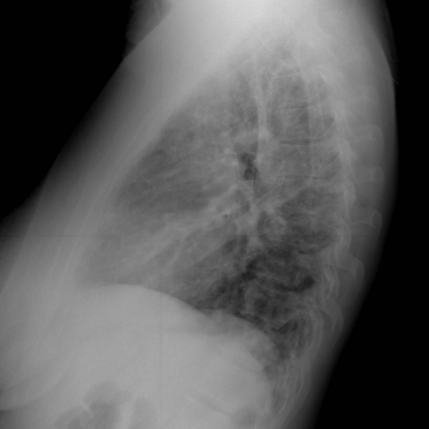

# M1独立训练种子：11754_8353800651209

[原始预测/反思/规则候选](../../traces/seed/11754_8353800651209.json)

来源：[ChestAgentBench固定版本](https://huggingface.co/datasets/wanglab/chest-agent-bench/tree/921e60440927f9893228d843c0206b755744252a) · [Eurorad病例](https://www.eurorad.org/case/11754)。数字前缀只用于来源链接，病例排除仍使用显式case_id派生hash。

本例属于独立memory_train，未与评测病例共享case_hash。原参考标签只用于授权的训练预热；模型影像观察仍未独立验证。

```text
Based on the provided chest X-ray findings and clinical history, which of the following interpretations most accurately aligns with the observed radiographic features and clinical context of the patient?

A) The chest X-ray findings of bilateral nodular opacities and diffuse interstitial thickening suggest acute infectious pneumonia, consistent with the patient's symptoms of fever and cough.
B) The presence of bilateral nodular opacities predominantly in the lower lobes and diffuse interstitial thickening on the chest X-ray, combined with the patient's history, strongly supports a diagnosis of silicone embolism syndrome.
C) The observed diffuse interstitial thickening on the chest X-ray is indicative of cryptogenic organizing pneumonia, a possible differential considering the patient's acute respiratory symptoms.
D) The chest X-ray findings are more consistent with pulmonary thromboembolism, given the bilateral nature of the opacities and the patient's acute onset of symptoms.
E) The chest X-ray demonstrates findings typical of fat embolism syndrome, characterized by bilateral nodular opacities and interstitial thickening, which correlate with the patient's presentation.
F) The radiographic findings on the chest X-ray do not suggest any acute pathology and are likely incidental, unrelated to the patient's symptoms and history.
```




参考选项全文：The presence of bilateral nodular opacities predominantly in the lower lobes and diffuse interstitial thickening on the chest X-ray, combined with the patient's history, strongly supports a diagnosis of silicone embolism syndrome.

