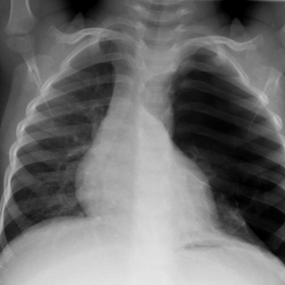
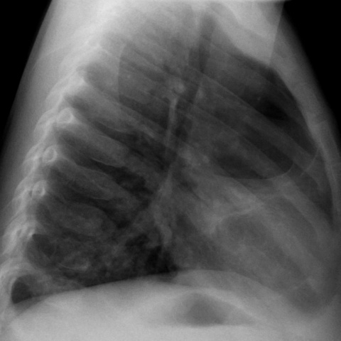
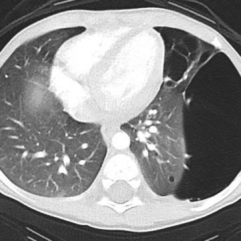
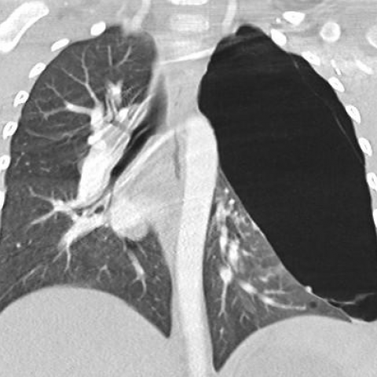

# M1独立训练种子：11841_8353800650801

[原始预测/反思/规则候选](../../traces/seed/11841_8353800650801.json)

来源：[ChestAgentBench固定版本](https://huggingface.co/datasets/wanglab/chest-agent-bench/tree/921e60440927f9893228d843c0206b755744252a) · [Eurorad病例](https://www.eurorad.org/case/11841)。数字前缀只用于来源链接，病例排除仍使用显式case_id派生hash。

本例属于独立memory_train，未与评测病例共享case_hash。原参考标签只用于授权的训练预热；模型影像观察仍未独立验证。

```text
Based on the chest X-ray findings and the clinical history of a 21-month-old boy with a left-sided abdominal mass, which of the following statements most accurately describes the relationship and likely diagnosis of the thoracic lesions observed in Figures 1a, 1b, 2a, and 2b?

A) The large radiolucent lesion in the left upper and middle hemithorax with a mediastinal shift to the right suggests a diagnosis of congenital lobar emphysema, unrelated to the renal findings.
B) The large radiolucent lesion and cystic air-containing cavities in the left upper lobe with mediastinal shift to the right are indicative of Pleuropulmonary Blastoma (PPB) type 1, which is consistent with the renal findings.
C) The thoracic lesions represent a pneumothorax and are unrelated to the abdominal mass, suggesting a separate congenital condition.
D) The presence of multiple cystic lesions and mediastinal shift suggests CPAM type 1, with no correlation to the abdominal mass.
E) The findings are consistent with necrotic pneumonia with cavitary lesions, unrelated to the renal cystic masses.
F) The presence of cystic air-containing cavities and pleural adhesions indicates a primary infectious process rather than a neoplastic one.
```









参考选项全文：The large radiolucent lesion and cystic air-containing cavities in the left upper lobe with mediastinal shift to the right are indicative of Pleuropulmonary Blastoma (PPB) type 1, which is consistent with the renal findings.

