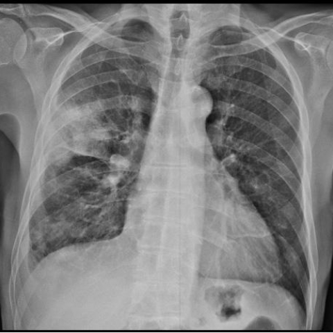
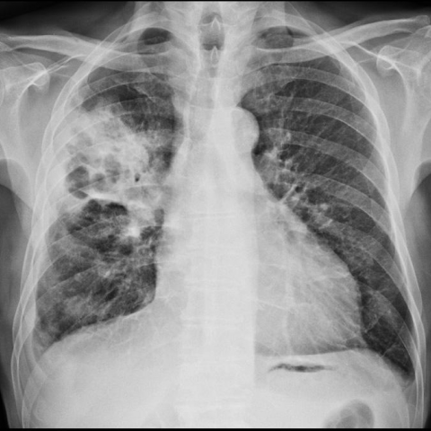

# M1独立训练种子：11861_8353800651374

[原始预测/反思/规则候选](../../traces/seed/11861_8353800651374.json)

来源：[ChestAgentBench固定版本](https://huggingface.co/datasets/wanglab/chest-agent-bench/tree/921e60440927f9893228d843c0206b755744252a) · [Eurorad病例](https://www.eurorad.org/case/11861)。数字前缀只用于来源链接，病例排除仍使用显式case_id派生hash。

本例属于独立memory_train，未与评测病例共享case_hash。原参考标签只用于授权的训练预热；模型影像观察仍未独立验证。

```text
Based on the chest X-ray findings in Figure 1a and Figure 1c, what is the most likely explanation for the progression of the observed lesion in the right upper lobe, considering the patient's clinical presentation of fever, cough, and moderate dyspnea?

A) The lesion represents a resolving bacterial pneumonia with cavitation.
B) The lesion indicates a progressing fungal infection with cavitation.
C) The lesion suggests a primary lung cancer with necrosis and cavitation.
D) The lesion is due to tuberculosis with cavitation.
E) The lesion represents a pulmonary infarction with cavitation.
F) The lesion is consistent with a resolving pulmonary embolism.
```





参考选项全文：The lesion suggests a primary lung cancer with necrosis and cavitation.

