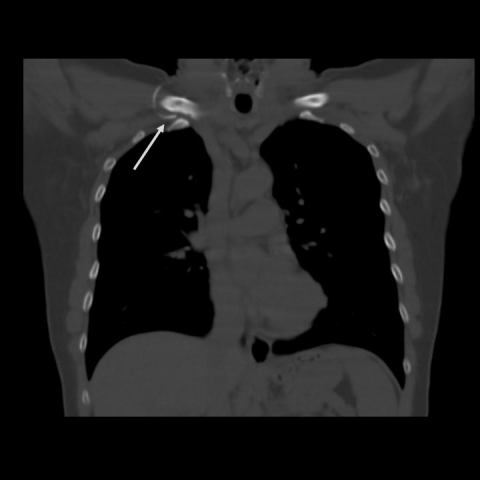
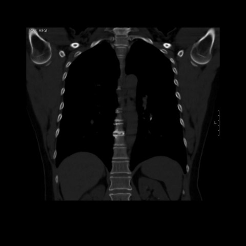
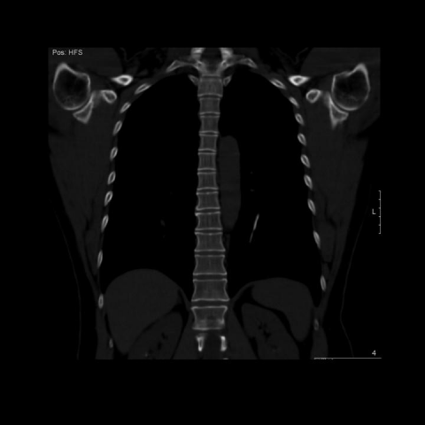

# M1独立训练种子：11945_8353800664098

[原始预测/反思/规则候选](../../traces/seed/11945_8353800664098.json)

来源：[ChestAgentBench固定版本](https://huggingface.co/datasets/wanglab/chest-agent-bench/tree/921e60440927f9893228d843c0206b755744252a) · [Eurorad病例](https://www.eurorad.org/case/11945)。数字前缀只用于来源链接，病例排除仍使用显式case_id派生hash。

本例属于独立memory_train，未与评测病例共享case_hash。原参考标签只用于授权的训练预热；模型影像观察仍未独立验证。

```text
Based on the chest X-ray findings after the removal of the central venous catheter (Figure 3), what is the most likely location and clinical implication of the migrated catheter fragment?  
A) The fragment is located in the right atrium, potentially causing arrhythmias.  
B) The fragment is in the right pulmonary artery, posing a risk of pulmonary embolism.  
C) The fragment is in the left pulmonary artery, and due to the lack of sensory endings in the vascular endothelium, the patient remains asymptomatic.  
D) The fragment is lodged in the superior vena cava, possibly leading to superior vena cava syndrome.  
E) The fragment is in the left atrium, increasing the risk of systemic embolization.  
F) The fragment is in the descending aorta, causing increased risk of rupture.
```







参考选项全文：The fragment is in the left pulmonary artery, and due to the lack of sensory endings in the vascular endothelium, the patient remains asymptomatic.

