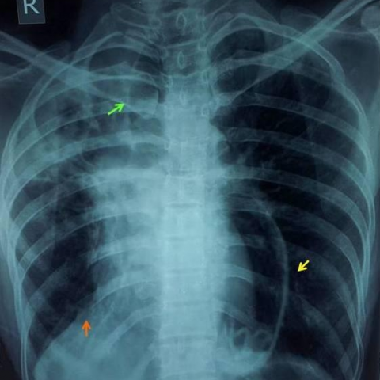
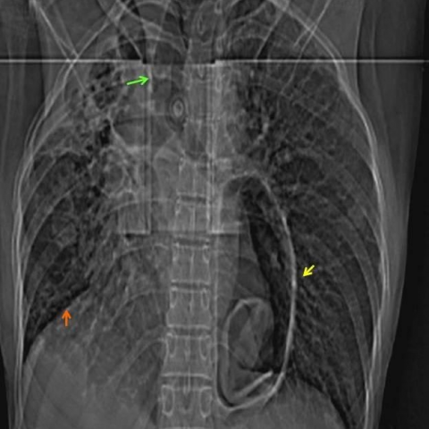

# M1独立训练种子：11977_8353800651530

[原始预测/反思/规则候选](../../traces/seed/11977_8353800651530.json)

来源：[ChestAgentBench固定版本](https://huggingface.co/datasets/wanglab/chest-agent-bench/tree/921e60440927f9893228d843c0206b755744252a) · [Eurorad病例](https://www.eurorad.org/case/11977)。数字前缀只用于来源链接，病例排除仍使用显式case_id派生hash。

本例属于独立memory_train，未与评测病例共享case_hash。原参考标签只用于授权的训练预热；模型影像观察仍未独立验证。

```text
Given the chest X-ray findings and the clinical history of the 25-year-old farmer from India, which of the following is the most likely diagnosis? Consider the presence of a well-defined cavity in the left lower zone with collapsed membranes and multiple cavities in the right apex, along with fibrotic changes and tracheal traction. 

A. Tuberculous lung abscess with atelectasis
B. Fungal colonization of tuberculous cavities
C. Spontaneously ruptured pulmonary hydatid cyst with concomitant tuberculosis
D. Primary lung cancer with secondary infection
E. Pneumonia with lung necrosis
F. Chronic obstructive pulmonary disease with emphysematous changes
```





参考选项全文：Spontaneously ruptured pulmonary hydatid cyst with concomitant tuberculosis

