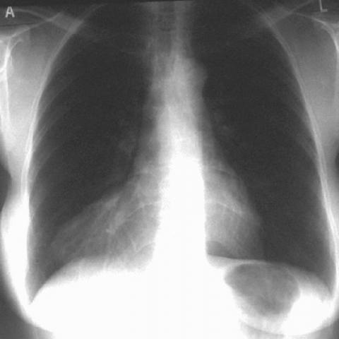
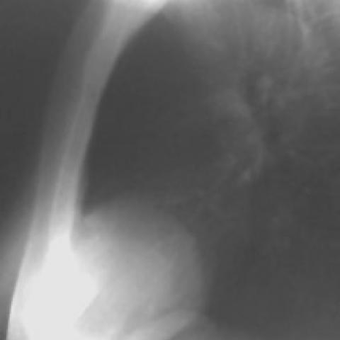

# M1独立训练种子：1198_8353802023366

[原始预测/反思/规则候选](../../traces/seed/1198_8353802023366.json)

来源：[ChestAgentBench固定版本](https://huggingface.co/datasets/wanglab/chest-agent-bench/tree/921e60440927f9893228d843c0206b755744252a) · [Eurorad病例](https://www.eurorad.org/case/1198)。数字前缀只用于来源链接，病例排除仍使用显式case_id派生hash。

本例属于独立memory_train，未与评测病例共享case_hash。原参考标签只用于授权的训练预热；模型影像观察仍未独立验证。

```text
Based on the chest X-ray findings in Figure 1a and Figure 1b, which of the following is the most accurate description of the mass's location and its relationship to surrounding structures?

A) The mass is located in the right upper lung zone, adjacent to the right hilum, and obscures the right heart border.
B) The mass is situated in the right lower lung zone, merging with the right heart border, and silhouettes the right hemidiaphragm anteriorly.
C) The mass is in the left lower lung zone, obscuring the left heart border, and is separate from the diaphragm.
D) The mass is located centrally within the mediastinum, separate from the cardiac silhouette and diaphragm.
E) The mass is in the right middle lung zone, adjacent to the pleura, and is not in contact with the diaphragm.
F) The mass is located in the left upper lung zone, overlapping the left clavicle and extending to the apex.
```





参考选项全文：The mass is situated in the right lower lung zone, merging with the right heart border, and silhouettes the right hemidiaphragm anteriorly.

