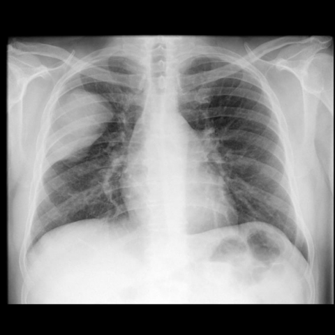
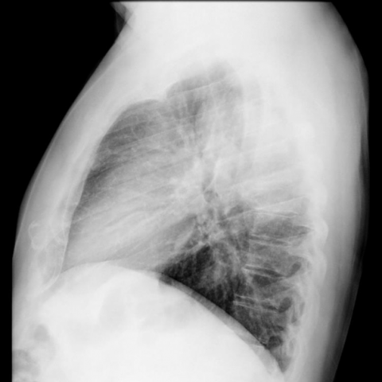

# M1独立训练种子：12032_8353800650981

[原始预测/反思/规则候选](../../traces/seed/12032_8353800650981.json)

来源：[ChestAgentBench固定版本](https://huggingface.co/datasets/wanglab/chest-agent-bench/tree/921e60440927f9893228d843c0206b755744252a) · [Eurorad病例](https://www.eurorad.org/case/12032)。数字前缀只用于来源链接，病例排除仍使用显式case_id派生hash。

本例属于独立memory_train，未与评测病例共享case_hash。原参考标签只用于授权的训练预热；模型影像观察仍未独立验证。

```text
Based on the chest X-ray findings, which of the following statements most accurately describes the characteristics and potential diagnosis of the lesion observed in the right hemithorax of the 55-year-old patient with a history of Hodgkin lymphoma?  
A) The lesion is a poorly-defined mass with evidence of rib destruction, suggesting a high likelihood of lymphoma recurrence.  
B) The lesion is a well-defined mass without rib destruction, consistent with an extrapulmonary neoplastic process, possibly Askin tumor.  
C) The lesion is a homogeneous mass with rib involvement, indicative of metastatic disease.  
D) The lesion is an ill-defined pleural-based mass with calcifications, suggesting a benign process.  
E) The lesion is a well-circumscribed mass with evidence of mediastinal invasion, favoring a diagnosis of neuroblastoma.  
F) The lesion is a poorly-circumscribed mass showing signs of pneumothorax, consistent with rhabdomyosarcoma.
```





参考选项全文：The lesion is a well-defined mass without rib destruction, consistent with an extrapulmonary neoplastic process, possibly Askin tumor.

