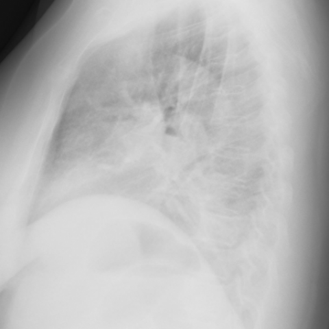

# M1独立训练种子：12127_8353800664791

[原始预测/反思/规则候选](../../traces/seed/12127_8353800664791.json)

来源：[ChestAgentBench固定版本](https://huggingface.co/datasets/wanglab/chest-agent-bench/tree/921e60440927f9893228d843c0206b755744252a) · [Eurorad病例](https://www.eurorad.org/case/12127)。数字前缀只用于来源链接，病例排除仍使用显式case_id派生hash。

本例属于独立memory_train，未与评测病例共享case_hash。原参考标签只用于授权的训练预热；模型影像观察仍未独立验证。

```text
Based on the chest X-ray findings from the posteroanterior and lateral views (Fig. 1a, 1b), which of the following is the most likely description of the observed mass, and what is its clinical implication in this patient?
A) A well-defined, centrally located mass in the right upper lobe, suggesting a benign lesion.
B) An irregular, ill-defined mass in the left lower lobe extending to the mediastinum, consistent with pulmonary epithelioid haemangioendothelioma (PEH).
C) A calcified nodule in the left upper lobe, indicating granulomatous disease.
D) A solitary, round mass in the left lower lobe with sharp margins, typical of a bronchogenic carcinoma.
E) Multiple small nodules scattered throughout both lungs, suggesting metastatic disease.
F) A large pleural effusion on the left side with mediastinal shift, indicating severe congestive heart failure.
```




参考选项全文：An irregular, ill-defined mass in the left lower lobe extending to the mediastinum, consistent with pulmonary epithelioid haemangioendothelioma (PEH).

