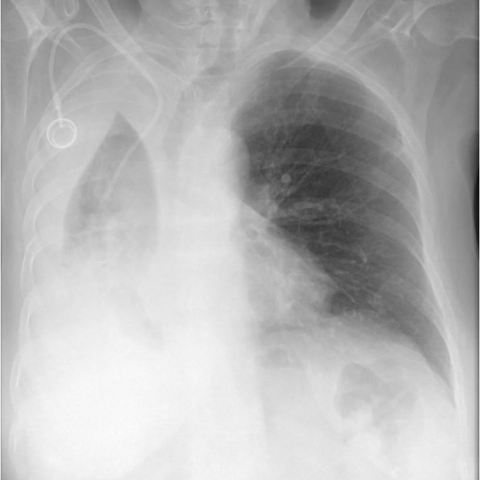
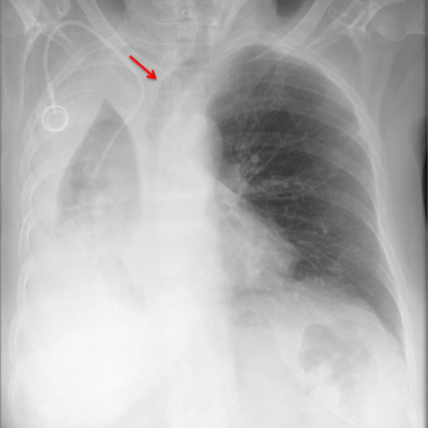

# M1独立训练种子：12183_8353800664389

[原始预测/反思/规则候选](../../traces/seed/12183_8353800664389.json)

来源：[ChestAgentBench固定版本](https://huggingface.co/datasets/wanglab/chest-agent-bench/tree/921e60440927f9893228d843c0206b755744252a) · [Eurorad病例](https://www.eurorad.org/case/12183)。数字前缀只用于来源链接，病例排除仍使用显式case_id派生hash。

本例属于独立memory_train，未与评测病例共享case_hash。原参考标签只用于授权的训练预热；模型影像观察仍未独立验证。

```text
Based on Figure 1a and Figure 1b, which of the following observations and interpretations is most consistent with the findings of right lung atelectasis, taking into account the clinical history of metastatic melanoma and the current symptoms?

A) Right lung atelectasis is evident, with a significant mediastinal shift to the left, suggesting left-sided pleural effusion.
B) Right lung atelectasis is evident, with a significant mediastinal shift to the right, consistent with a right-sided pleural effusion.
C) Right lung atelectasis is evident, with no mediastinal shift, suggesting no pleural effusion.
D) Right lung atelectasis is evident, with a significant mediastinal shift to the right, suggesting right main bronchus obstruction.
E) Right lung atelectasis is evident, with a significant mediastinal shift to the left, suggesting right main bronchus obstruction.
F) Right lung atelectasis is evident, with a significant mediastinal shift to the right, suggesting left main bronchus obstruction.
```





参考选项全文：Right lung atelectasis is evident, with a significant mediastinal shift to the right, suggesting right main bronchus obstruction.

