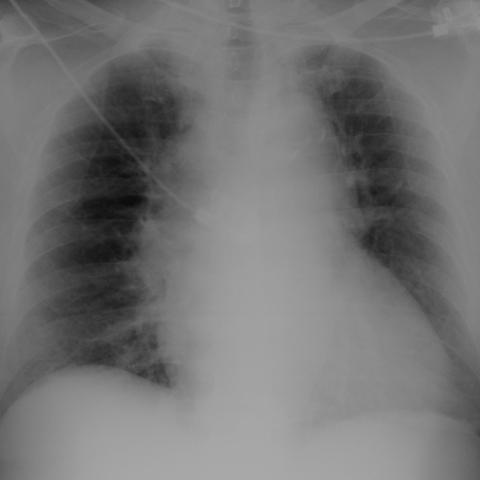

# M1独立训练种子：12305_8353800650918

[原始预测/反思/规则候选](../../traces/seed/12305_8353800650918.json)

来源：[ChestAgentBench固定版本](https://huggingface.co/datasets/wanglab/chest-agent-bench/tree/921e60440927f9893228d843c0206b755744252a) · [Eurorad病例](https://www.eurorad.org/case/12305)。数字前缀只用于来源链接，病例排除仍使用显式case_id派生hash。

本例属于独立memory_train，未与评测病例共享case_hash。原参考标签只用于授权的训练预热；模型影像观察仍未独立验证。

```text
Based solely on the chest X-ray findings in Figure 1, what is the most likely cause of the widened mediastinum and enlarged cardiac silhouette in this patient with dizziness and hypotension, considering the differential diagnoses provided in the clinical case?
A) Acute pulmonary thromboembolism
B) Penetrating atherosclerotic ulcer
C) Acute aortic dissection
D) Cardiac tamponade
E) Acute coronary syndrome
F) Acute heart failure
```



参考选项全文：Penetrating atherosclerotic ulcer

原历史只保留合法选项，未保留完整理由；不得从反思推断当时真实思路。
