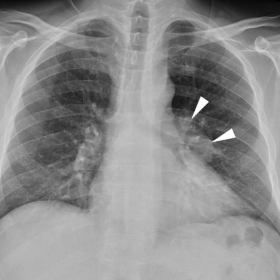
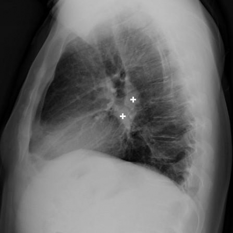
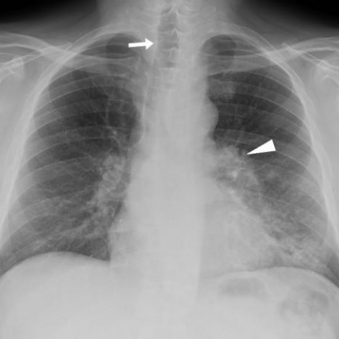
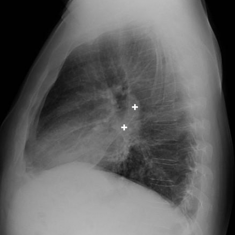
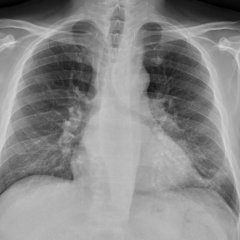
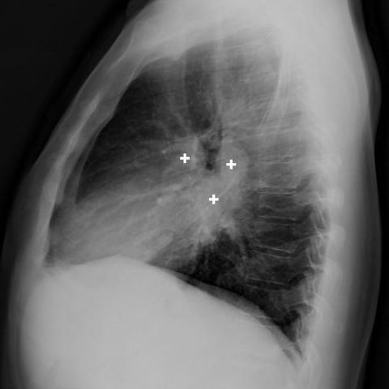

# M1独立训练种子：12325_8353800664389

[原始预测/反思/规则候选](../../traces/seed/12325_8353800664389.json)

来源：[ChestAgentBench固定版本](https://huggingface.co/datasets/wanglab/chest-agent-bench/tree/921e60440927f9893228d843c0206b755744252a) · [Eurorad病例](https://www.eurorad.org/case/12325)。数字前缀只用于来源链接，病例排除仍使用显式case_id派生hash。

本例属于独立memory_train，未与评测病例共享case_hash。原参考标签只用于授权的训练预热；模型影像观察仍未独立验证。

```text
Based on the chest X-ray figures, what is the most likely explanation for the radiological changes observed over the course of the antiretroviral therapy (ART) in this patient, specifically considering the tracheal deviation and lymphadenopathy?  
A) Progressive bacterial pneumonia without ART response  
B) Development of non-Hodgkin lymphoma  
C) IRIS with Mycobacterium avium complex infection  
D) Reactivation of tuberculosis  
E) New onset of sarcoidosis  
F) Drug-induced pulmonary toxicity
```













参考选项全文：IRIS with Mycobacterium avium complex infection

