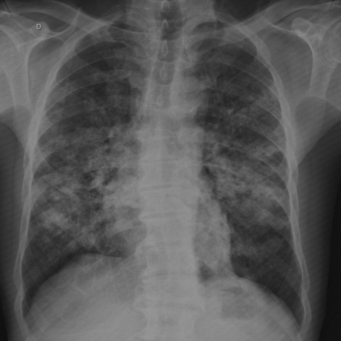

# M1独立训练种子：12326_8353800664215

[原始预测/反思/规则候选](../../traces/seed/12326_8353800664215.json)

来源：[ChestAgentBench固定版本](https://huggingface.co/datasets/wanglab/chest-agent-bench/tree/921e60440927f9893228d843c0206b755744252a) · [Eurorad病例](https://www.eurorad.org/case/12326)。数字前缀只用于来源链接，病例排除仍使用显式case_id派生hash。

本例属于独立memory_train，未与评测病例共享case_hash。原参考标签只用于授权的训练预热；模型影像观察仍未独立验证。

```text
Based on the chest X-ray in Figure 1, which of the following findings is most consistent with the diagnosis of South American blastomycosis (paracoccidioidomycosis) in this patient, and where is it predominantly located?

A) Homogeneous airspace consolidation, predominantly in the right upper lobe.
B) Patchy multifocal opacities and nodules of various sizes, predominantly in both lower lobes.
C) Large cavitary lesions, predominantly in the left upper lobe.
D) Ground-glass opacities, predominantly in the right lower lobe.
E) Diffuse reticular opacities, predominantly in the left lower lobe.
F) Single large nodule with well-defined margins, predominantly in the right middle lobe.
```



参考选项全文：Patchy multifocal opacities and nodules of various sizes, predominantly in both lower lobes.

原历史只保留合法选项，未保留完整理由；不得从反思推断当时真实思路。
