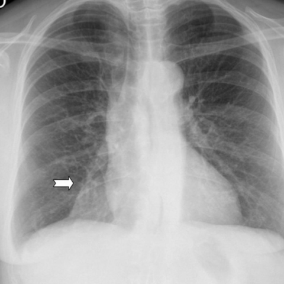
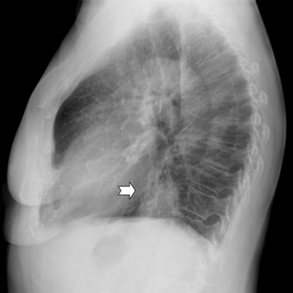

# M1独立训练种子：12349_8353800664140

[原始预测/反思/规则候选](../../traces/seed/12349_8353800664140.json)

来源：[ChestAgentBench固定版本](https://huggingface.co/datasets/wanglab/chest-agent-bench/tree/921e60440927f9893228d843c0206b755744252a) · [Eurorad病例](https://www.eurorad.org/case/12349)。数字前缀只用于来源链接，病例排除仍使用显式case_id派生hash。

本例属于独立memory_train，未与评测病例共享case_hash。原参考标签只用于授权的训练预热；模型影像观察仍未独立验证。

```text
Based on the chest X-ray findings, what is the most likely diagnosis for the well-defined opacity observed in the right lower lobe of the 63-year-old woman with symptoms of fever, cough, expectoration, haemoptysis, and general malaise?
A) Right lower lobe pneumonia
B) Pulmonary hydatid cyst
C) Lung cancer
D) Pulmonary abscess
E) Atelectasis
F) Pleural effusion
```





参考选项全文：Pulmonary hydatid cyst

