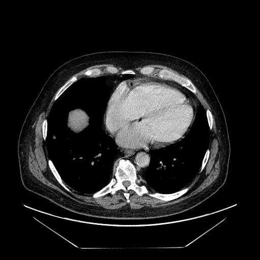
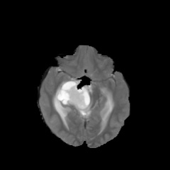
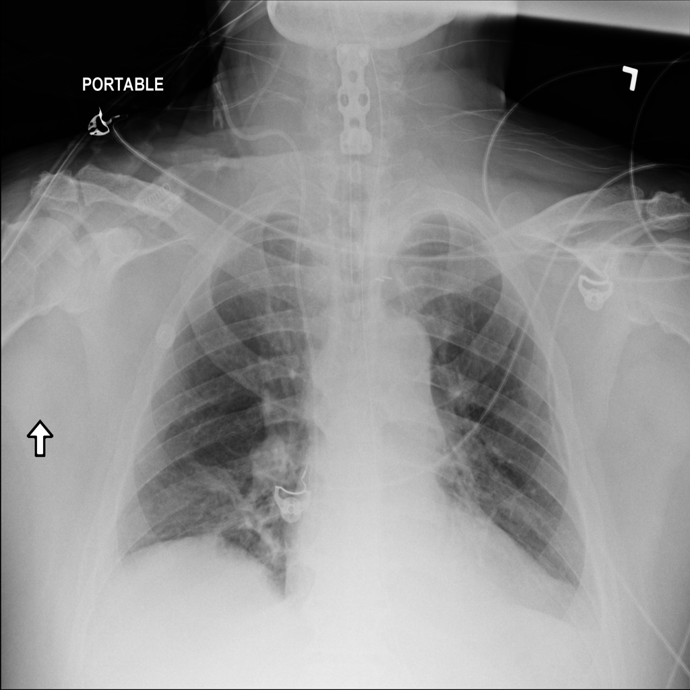
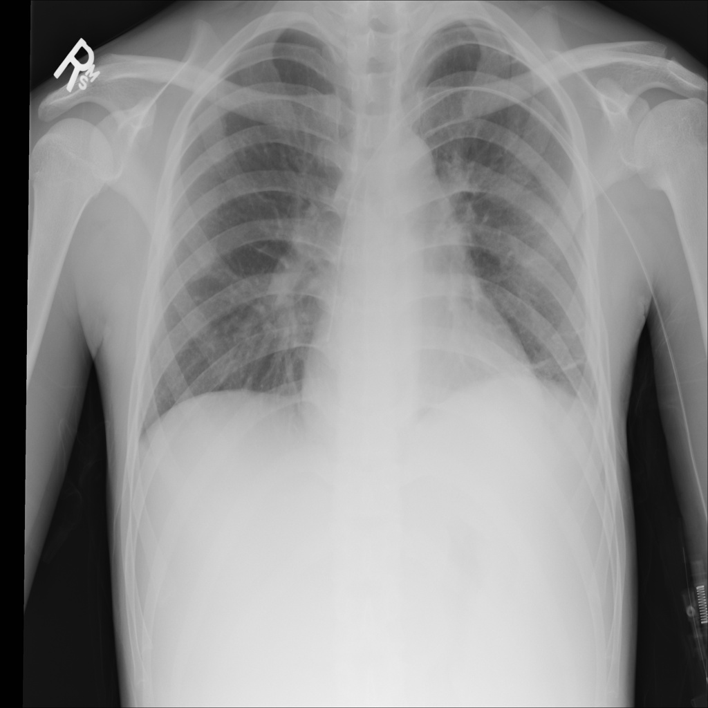
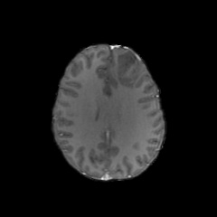
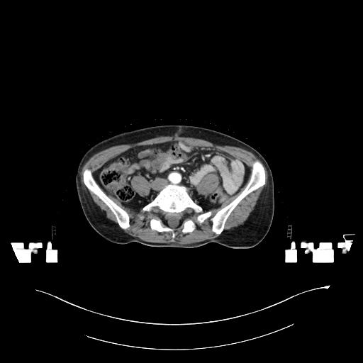

# 逐题差异

同一验证题序中的首答结果。`M5_only_correct` 表示原始 M5 正确、S10 错误；`S10_only_correct` 表示 S10 纠正原始 M5 的错误。

## 第 17 题 · rad_restruct · m5rsi_rad_3159_0085

Is there anything abnormal in the mediastinum?

- A. yes
- B. no

参考答案：{'answer': 'A', 'answer_text': 'yes'}

M5：**A. yes**；S10：**B. no**。

M5 保存的理由：The verifier confirmed a prominent/widened mediastinal contour on this AP view, supporting the presence of an abnormality despite potential technique-related exaggeration.

S10 保存的理由：The verify tool confirmed the proposed answer 'no' as correct after resolving conflicting VLM outputs, and visual inspection shows a normal mediastinal contour without widening or mass.

[M5 完整轨迹](validation/M5/q000017.json) · [S10 完整轨迹](validation/S10/q000017.json)

[原图 1: CXR3159_IM-1487-1001-0001.png](https://openi.nlm.nih.gov/detailedresult?img=CXR3159_IM-1487-1001-0001)

## 第 25 题 · slake · m5rsi_slake_10032

Does the picture contain liver?

参考答案：{'answer': 'Yes', 'answer_text': 'Yes'}

M5：**no**；S10：**Yes**。

M5 保存的理由：The image is an axial CT scan at the level of the heart showing cardiac chambers and lung parenchyma, with no visible liver tissue which would appear inferior to this slice.

S10 保存的理由：The axial CT image shows the liver dome as a large soft-tissue organ in the right upper quadrant adjacent to the heart.

[M5 完整轨迹](validation/M5/q000025.json) · [S10 完整轨迹](validation/S10/q000025.json)

[原图 1: source.jpg](https://huggingface.co/datasets/BoKelvin/SLAKE/blob/main/imgs.zip)

## 第 29 题 · slake · m5rsi_slake_10575

Which part of the body does this image belong to?

参考答案：{'answer': 'Head', 'answer_text': 'Head'}

M5：**brain**；S10：**head**。

M5 保存的理由：Axial MRI shows characteristic brain anatomy including temporal lobes and midline structures.

S10 保存的理由：The image shows an axial cross-section of the brain with visible cerebral hemispheres and ventricles.

[M5 完整轨迹](validation/M5/q000029.json) · [S10 完整轨迹](validation/S10/q000029.json)

[原图 1: source.jpg](https://huggingface.co/datasets/BoKelvin/SLAKE/blob/main/imgs.zip)

## 第 42 题 · rad_restruct · m5rsi_rad_3609_0012

Are there any diseases in the cardiovascular system?

- A. yes
- B. no

参考答案：{'answer': 'A', 'answer_text': 'yes'}

M5：**A**；S10：**B. no**。

M5 保存的理由：The cardiac silhouette appears enlarged, suggesting cardiomegaly which is a cardiovascular disease.

S10 保存的理由：Multiple independent VLMs and the verification audit confirm no cardiomegaly or vascular congestion, indicating absence of cardiovascular disease on this CXR.

[M5 完整轨迹](validation/M5/q000042.json) · [S10 完整轨迹](validation/S10/q000042.json)

[原图 1: CXR3609_IM-1782-2001.png](https://openi.nlm.nih.gov/detailedresult?img=CXR3609_IM-1782-2001)

## 第 60 题 · rad_restruct · m5rsi_rad_1072_0026

Is there anything abnormal in the cardiovascular system?

- A. yes
- B. no

参考答案：{'answer': 'A', 'answer_text': 'yes'}

M5：**A. yes**；S10：**B. no**。

M5 保存的理由：The presence of a central venous catheter coursing into the superior vena cava/right atrium constitutes an abnormality in the cardiovascular system.

S10 保存的理由：The cardiac silhouette is not enlarged and mediastinal contours are normal on this AP view, with only external ECG leads present.

[M5 完整轨迹](validation/M5/q000060.json) · [S10 完整轨迹](validation/S10/q000060.json)

[原图 1: CXR1072_IM-0052-1001-0002.png](https://openi.nlm.nih.gov/detailedresult?img=CXR1072_IM-0052-1001-0002)

## 第 74 题 · slake · m5rsi_slake_9916

Are there abnormalities in this image?

参考答案：{'answer': 'Yes', 'answer_text': 'Yes'}

M5：**No**；S10：**Yes**。

M5 保存的理由：Two independent visual QA models assessed the chest X-ray as normal with no detectable abnormalities such as consolidation, effusion, pneumothorax, or cardiomegaly.

S10 保存的理由：The verifier identified multiple abnormalities including cervical spine hardware, a central venous catheter, and an arrow-indicated rounded opacity in the right lower lung zone, which was confirmed by the expert tool when specifically queried.

[M5 完整轨迹](validation/M5/q000074.json) · [S10 完整轨迹](validation/S10/q000074.json)

[原图 1: source.jpg](https://huggingface.co/datasets/BoKelvin/SLAKE/blob/main/imgs.zip)

## 第 80 题 · slake · m5rsi_slake_10367

Can atelectasis be observed on the lower right lung in this picture?

参考答案：{'answer': 'No', 'answer_text': 'No'}

M5：**No**；S10：**Yes**。

M5 保存的理由：The right lower lung shows no volume-loss signs of atelectasis such as mediastinal shift, diaphragm elevation, or rib crowding.

S10 保存的理由：The verify tool confirmed the proposed answer is correct after auditing original pixels, resolving model disagreement in favor of atelectasis presence.

[M5 完整轨迹](validation/M5/q000080.json) · [S10 完整轨迹](validation/S10/q000080.json)

[原图 1: source.jpg](https://huggingface.co/datasets/BoKelvin/SLAKE/blob/main/imgs.zip)

## 第 81 题 · rad_restruct · m5rsi_rad_10_0003

Are there any diseases in the lung?

- A. yes
- B. no

参考答案：{'answer': 'A', 'answer_text': 'yes'}

M5：**A**；S10：**B. no**。

M5 保存的理由：The zoomed ROI clearly reveals a discrete, well-circumscribed pulmonary nodule in the right mid-lung zone, confirming the presence of lung disease.

S10 保存的理由：Verification audit confirmed correctness of negative finding despite initial expert disagreement.

[M5 完整轨迹](validation/M5/q000081.json) · [S10 完整轨迹](validation/S10/q000081.json)

[原图 1: CXR10_IM-0002-2001.png](https://openi.nlm.nih.gov/detailedresult?img=CXR10_IM-0002-2001)

## 第 94 题 · rad_restruct · m5rsi_rad_677_0083

Are there any diseases in the pleura?

- A. yes
- B. no

参考答案：{'answer': 'A', 'answer_text': 'yes'}

M5：**A. yes**；S10：**B. no**。

M5 保存的理由：The verifier confirmed the presence of pleural disease, supported by visual evidence of blunted costophrenic angles and basal opacity consistent with pleural effusion in the ROI crop.

S10 保存的理由：Verified audit confirms no definite pleural effusion, pneumothorax, or thickening; right lower opacity is parenchymal.

[M5 完整轨迹](validation/M5/q000094.json) · [S10 完整轨迹](validation/S10/q000094.json)

[原图 1: CXR677_IM-2249-1001.png](https://openi.nlm.nih.gov/detailedresult?img=CXR677_IM-2249-1001)

## 第 97 题 · slake · m5rsi_slake_10601

Is this an MRI image with T1 weighted?

参考答案：{'answer': 'Yes', 'answer_text': 'Yes'}

M5：**Yes**；S10：**No**。

M5 保存的理由：The image shows dark CSF and white matter brighter than gray matter, which are characteristic features of T1-weighted MRI.

S10 保存的理由：The image shows dark white matter and bright CSF, which is characteristic of T2-weighted MRI rather than T1-weighted.

[M5 完整轨迹](validation/M5/q000097.json) · [S10 完整轨迹](validation/S10/q000097.json)

[原图 1: source.jpg](https://huggingface.co/datasets/BoKelvin/SLAKE/blob/main/imgs.zip)

## 第 100 题 · slake · m5rsi_slake_10863

Does the picture contain spinal cord?

参考答案：{'answer': 'Yes', 'answer_text': 'Yes'}

M5：**yes**；S10：**No**。

M5 保存的理由：The axial CT image shows a lumbar vertebra with a visible spinal canal containing the thecal sac/spinal cord elements.

S10 保存的理由：The image shows a pelvic CT slice at the sacral level where the spinal cord has already terminated.

[M5 完整轨迹](validation/M5/q000100.json) · [S10 完整轨迹](validation/S10/q000100.json)

[原图 1: source.jpg](https://huggingface.co/datasets/BoKelvin/SLAKE/blob/main/imgs.zip)

