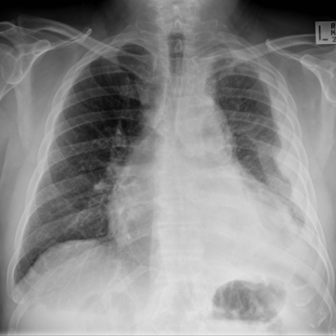
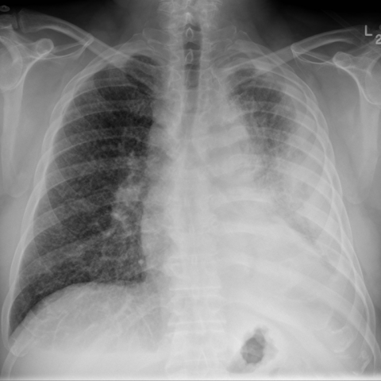

# Official gain: 10569_8353800725393

Post-run explicit answers: D **B**, M **B**, P **B**, reference **B**. Frozen runtime answers: D B, M None, P B; original records unchanged.

[Complete observable requests, tools and stages](../traces/10569_8353800725393.json) · [Original benchmark case](../../v12/results/cases/10569_8353800725393.md) · [D cached original observable request](../../direct_qwen60/requests/10569_8353800725393.json)

```text
Based on the chest X-ray images provided, which of the following best describes the changes observed in the patient's condition over the 6-month period, specifically focusing on the contralateral lung?  
A) There is a decrease in the number of miliary nodules in the right lung, suggesting a response to chemotherapy.  
B) There is an increase in the number and distribution of miliary nodules in the right lung, consistent with metastatic spread.  
C) The miliary nodules in the right lung remain unchanged, indicating a stable disease state.  
D) The right lung shows new large masses instead of miliary nodules, indicating a potential new primary malignancy.  
E) The right lung exhibits alveolar opacities rather than miliary nodules, suggesting an infectious process.  
F) There is no significant change in the pleural thickening of the left hemithorax.
```





## D

```text
Answer: B  
Reason: Comparing Figure 1a and Figure 1b (6 months apart), the right lung—contralateral to the left-sided pleural abnormality—shows a marked increase in diffuse, fine nodular opacities (miliary pattern) in Figure 1b, consistent with progression of metastatic disease. The left hemithorax shows pleural thickening/effusion in both, but the question specifically asks about the contralateral (right) lung.
```

## M

```text
I've exhausted my tool budget (4 medical tool calls). Let me analyze what I have:

From the reports:
- Figure 1a: "no focal infiltrate", "no evidence of pneumonia"
- Figure 1b: "the right lung is clear", "stable appearance of right hilar mass"

But visually examining the images again:
- Figure 1a: Left lung has more prominent opacities, right lung appears relatively clearer
- Figure 1b: Right lung shows more diffuse, fine nodular opacities that appear more numerous than in Figure 1a

The key issue is that the automated reports may not be accurately describing miliary patterns. Miliary nodules are small (1-3mm), diffuse, and evenly distributed throughout the lung fields - a pattern that might be missed by automated systems that focus on larger masses.

Looking at the question options again:
A) Decrease in miliary nodules in right lung
B) Increase in number and distribution of miliary nodules in right lung
C) Unchanged miliary nodules
D) New large masses instead of miliary nodules
E) Alveolar opacities rather than miliary nodules
F) No significant change in pleural thickening of left hemithorax

Based on my visual assessment of the images (not relying solely on the tool outputs which seem inconsistent), Figure 1b shows more diffuse nodular opacities in the right lung compared to Figure 1a. The pattern appears more consistent with miliary spread - small, numerous, and widespread nodules.

The question asks specifically about the "contralateral lung" - if the primary disease was in the left lung initially (which appears more affected in Figure 1a), then the right lung would be contralateral, and its worsening would suggest metastatic spread.

Given the visual evidence of increased nodular opacities in the right lung in Figure 1b compared to Figure 1a, option B seems most appropriate: "There is an increase in the number and distribution of miliary nodules in the right lung, consistent with metastatic spread."

Return Answer: B) There is an increase in the number and distribution of miliary nodules in the right lung, consistent with metastatic spread.
```

## P

```text
Answer: B  
Reason: Comparing Figure 1a and Figure 1b (6 months apart), the right lung—contralateral to the left-sided pleural abnormality—shows a marked increase in diffuse, fine nodular opacities (miliary pattern) in Figure 1b, consistent with progression of metastatic disease. The left hemithorax shows pleural thickening/effusion in both, but the question specifically asks about the contralateral (right) lung.
```

