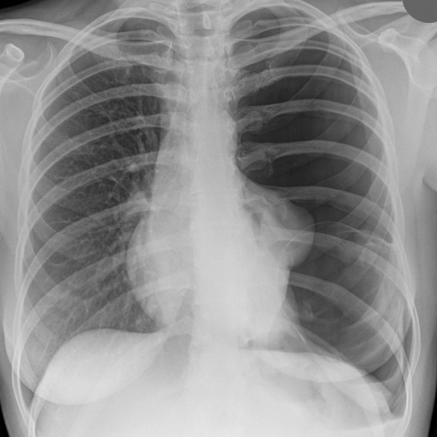
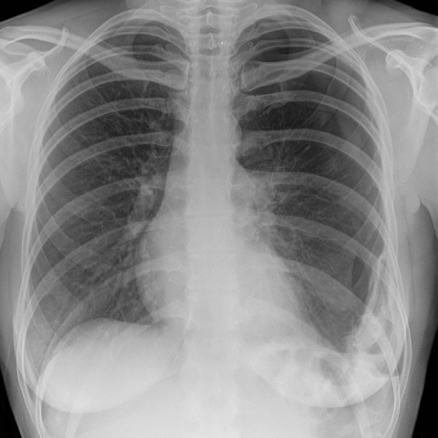

# Official gain: 11624_8353800763402

Post-run explicit answers: D **B**, M **B**, P **B**, reference **C**. Frozen runtime answers: D B, M None, P B; original records unchanged.

[Complete observable requests, tools and stages](../traces/11624_8353800763402.json) · [Original benchmark case](../../v12/results/cases/11624_8353800763402.md) · [D cached original observable request](../../direct_qwen60/requests/11624_8353800763402.json)

```text
Based on the chest X-ray images provided, which of the following best describes the changes observed in the left lung from Figure 1 to Figure 3, and the underlying reasoning for these observations?

A) Figure 1 shows a large left-sided pneumothorax and a cystic structure, and Figure 3 shows complete resolution of the pneumothorax with no cystic changes, indicating successful drainage and healing without residual cyst.

B) Figure 1 shows a large left-sided pneumothorax and a cystic structure, and Figure 3 shows a re-expansion of the left lung with disappearance of the cystic structure, indicating that the structure was likely a bullae that resolved with the pneumothorax.

C) Figure 1 shows a large left-sided pneumothorax and a cystic structure, and Figure 3 shows a recurrent pneumothorax with a persistent cystic structure, suggesting a bronchogenic cyst that contributes to recurrent pneumothorax due to its rupture.

D) Figure 1 shows a large left-sided pneumothorax and a cystic structure, and Figure 3 shows a stable lung with no pneumothorax, but a new opacity in the left lower zone, indicating an infection or abscess formation in the previously cystic area.

E) Figure 1 shows a large left-sided pneumothorax and a cystic structure, and Figure 3 shows a shrinking pneumothorax and disappearance of the cystic structure, suggesting that the cystic structure was a fluid collection that resolved spontaneously.
```





## D

```text
Answer: B  
Reason: Figure 1 shows a large left-sided pneumothorax with a well-defined cystic-appearing lucency (likely a bulla) in the left upper/mid zone. In Figure 3, the left lung is re-expanded, the pneumothorax has resolved, and the cystic lucency is no longer visible—consistent with a bulla that collapsed and was no longer apparent after re-expansion, rather than a persistent or new pathology. This pattern supports resolution of a bleb/bulla-associated pneumothorax.
```

## M

```text
I've exhausted my tool budget with 4 calls. Let me analyze what I have:

From the chest_xray_report_generator for Figure 1, the report states: "there is a large left pneumothorax with complete collapse of the left lung" and the impression mentions "interval placement of a left-sided pigtail catheter with significant interval decrease in size of the left pneumothorax." This suggests Figure 1 shows a large left pneumothorax that has been partially treated.

However, looking at the images visually:
- Figure 1: Shows a large left-sided pneumothorax with complete collapse of the left lung, and there appears to be a well-defined cystic structure in the left upper/mid zone.
- Figure 3: Shows re-expansion of the left lung with normal lung markings throughout, and the cystic structure is no longer visible.

The key question is whether the cystic structure was a bullae (air-filled space that can collapse with pneumothorax resolution) or a persistent cystic lesion like a bronchogenic cyst.

Given that the cystic structure disappeared completely with lung re-expansion, this strongly suggests it was likely a bullae or bleb that was part of the pneumothorax pathology rather than a separate persistent cystic lesion. Bullae can appear as cystic structures on X-ray and may collapse or become less apparent when the pneumothorax resolves and the lung re-expands.

Option B states: "Figure 1 shows a large left-sided pneumothorax and a cystic structure, and Figure 3 shows a re-expansion of the left lung with disappearance of the cystic structure, indicating that the structure was likely a bullae that resolved with the pneumothorax."

This matches my visual assessment and the clinical reasoning - bullae are common causes of spontaneous pneumothorax and would appear as cystic structures that resolve when the lung re-expands.

Return Answer: B followed by a short reason.
```

## P

```text
Answer: B) Figure 1 shows a large left-sided pneumothorax and a cystic structure, and Figure 3 shows a re-expansion of the left lung with disappearance of the cystic structure, indicating that the structure was likely a bullae that resolved with the pneumothorax.

Evidence: In Figure 1, a well-defined lucency (cystic-appearing structure) is present in the left upper/mid lung zone, and a pneumothorax extends from apex to ~6th rib anteriorly. In Figure 3, the pneumothorax is absent, the left lung is fully expanded, and the cystic lucency is no longer visible. The resolution of both the pneumothorax and the cystic structure together supports the interpretation of a bulla (air-filled bleb/bulla) that collapsed and reabsorbed with lung re-expansion, rather than a persistent or new pathology.
```

