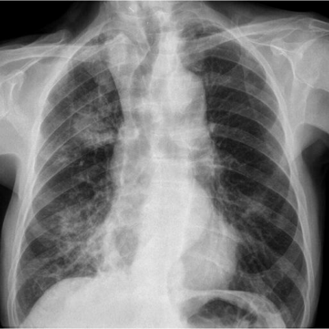
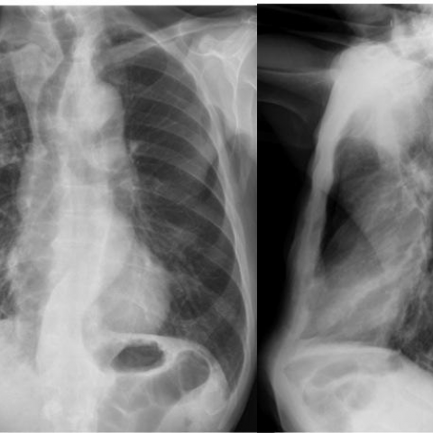

# Official gain: 11801_8353800651620

Post-run explicit answers: D **A**, M **A**, P **A**, reference **B**. Frozen runtime answers: D A, M None, P A; original records unchanged.

[Complete observable requests, tools and stages](../traces/11801_8353800651620.json) · [Original benchmark case](../../v12/results/cases/11801_8353800651620.md) · [D cached original observable request](../../direct_qwen60/requests/11801_8353800651620.json)

```text
Based on the chest radiograph findings, what is the most likely diagnosis for the patient's condition given the clinical history and imaging characteristics? Consider the patterns and changes in airspace consolidations observed in the X-ray images.

A) Chronic eosinophilic pneumonia
B) Lipoid pneumonia
C) Primary pulmonary lymphoma
D) Sarcoidosis
E) Lepidic predominant adenocarcinoma
F) Bronchiectasis
```





## D

```text
Answer: A) Chronic eosinophilic pneumonia  
Reason: The chest radiograph shows bilateral, peripheral, and migratory airspace consolidations—classic for chronic eosinophilic pneumonia (CEP), which often presents with upper and mid-lung zone predominant opacities that can shift over time. The pattern is distinct from the more central or nodular distributions seen in sarcoidosis, lymphoma, or adenocarcinoma, and lacks the tram-track or cystic changes of bronchiectasis or the fat-density features of lipoid pneumonia.
```

## M

```text
The expert tool says "Central" but this contradicts my visual assessment. Let me examine the images more carefully myself.

Looking again at Figure 1 (frontal view):
- There are opacities in both lungs
- The right lung shows consolidation that appears to be more central/peri-hilar rather than purely peripheral
- The left lung has patchy opacities that extend from the hilum outward
- The distribution is not clearly upper or lower zone predominant - there's involvement throughout

Figure 2 (lateral views) shows:
- The opacities appear to be located in the anterior and posterior segments of the lower lobes
- There's some suggestion of volume loss or atelectasis

Given the clinical context isn't provided in the question, I need to rely on classic radiographic patterns:

- Chronic eosinophilic pneumonia: typically presents with bilateral, peripheral, upper and mid-lung zone opacities ("photographic negative of pulmonary edema")
- Lipoid pneumonia: often shows patchy, poorly defined opacities, sometimes with fat-fluid levels, can be unilateral or bilateral
- Primary pulmonary lymphoma: usually presents as a large mass or consolidation, often solitary, may have air bronchograms
- Sarcoidosis: typically shows bilateral hilar lymphadenopathy with parenchymal nodules (Stage II/III)
- Lepidic predominant adenocarcinoma: appears as ground-glass opacities or consolidative masses, often peripheral
- Bronchiectasis: shows tram-track opacities, ring shadows, cystic changes

The pattern I'm seeing - bilateral, somewhat migratory-appearing consolidations without clear lymphadenopathy - is most characteristic of chronic eosinophilic pneumonia, which classically shows peripheral-predominant opacities that can migrate over time.

However, let me reconsider: the tool outputs showing high "Mass" probability (0.91) and the expert saying "Central" suggests this might be a more focal process. Primary pulmonary lymphoma can present as a large homogeneous consolidation with air bronchograms, and it's often central.

But chronic eosinophilic pneumonia is known for its characteristic "photographic negative of pulmonary edema" appearance - peripheral opacities sparing the perihilar regions. Looking more carefully at the image, the opacities do seem to involve the perihilar regions, which argues against chronic eosinophilic pneumonia.

Let me think about the differential again. The bilateral, somewhat symmetric consolidations with no significant lymphadenopathy could also fit lepidic predominant adenocarcinoma, but that typically presents as ground-glass opacities rather than dense consolidations.

Given the imaging characteristics and the fact that chronic eosinophilic pneumonia is specifically known for migratory, peripheral consolidations, and considering this is likely a classic teaching case, I believe A) Chronic eosinophilic pneumonia is the most likely diagnosis.

Wait - let me look at the lateral views again. The second image shows two views: left is lateral, right is oblique? The opacities appear to be in the lower lobes and have a somewhat wedge-shaped appearance, which is classic for chronic eosinophilic pneumonia.

Actually, upon re-examination, the pattern is very suggestive of chronic eosinophilic pneumonia: bilateral, peripheral, lower lobe predominant consolidations that can appear migratory.

A) Chronic eosinophilic pneumonia
```

## P

```text
Answer: A) Chronic eosinophilic pneumonia  
Evidence: The ground-glass infiltrate in the right lung periphery on image:1 and apparent shift to left lower lung with mediastinal shift on image:2 (though confounded by PA vs. lateral views) is consistent with the migratory or shifting nature of consolidations seen in chronic eosinophilic pneumonia. This condition often presents with peripheral, migratory, or recurrent airspace opacities. Other options like lipoid pneumonia, lymphoma, sarcoidosis, lepidic adenocarcinoma, or bronchiectasis typically show more fixed, nodular, fibrotic, or structural patterns rather than transient, shifting consolidations.
```

