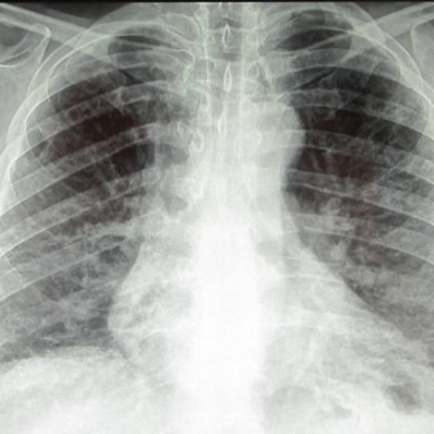
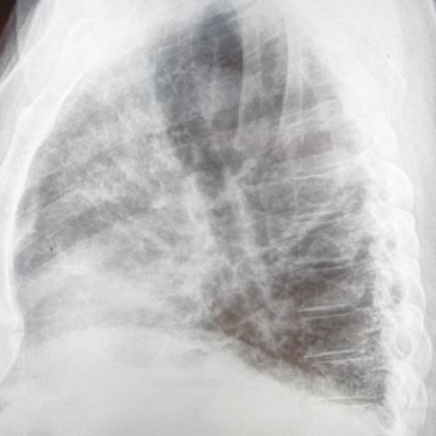
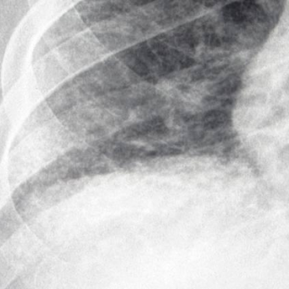
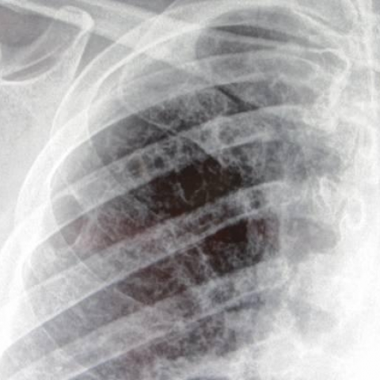

# Official gain: 11804_8353800651404

Post-run explicit answers: D **A**, M **A**, P **B**, reference **D**. Frozen runtime answers: D A, M A, P B; original records unchanged.

[Complete observable requests, tools and stages](../traces/11804_8353800651404.json) · [Original benchmark case](../../v12/results/cases/11804_8353800651404.md) · [D cached original observable request](../../direct_qwen60/requests/11804_8353800651404.json)

```text
Based on the chest X-rays provided, which of the following statements best describes the relationship and localization of the reticular markings and hyperlucency observed in the patient's lungs?

A) The lower lobe reticular markings are more prominent on the right side, and the upper lobe hyperlucency is more pronounced on the left side.
B) The lower lobe reticular markings are equally prominent on both sides, and the upper lobe hyperlucency is more pronounced on the right side.
C) The lower lobe reticular markings are more prominent on the left side, and the upper lobe hyperlucency is equally pronounced on both sides.
D) The lower lobe reticular markings are more prominent on the right side, and the upper lobe hyperlucency is equally pronounced on both sides.
E) The lower lobe reticular markings are equally prominent on both sides, and the upper lobe hyperlucency is more pronounced on the left side.
F) The lower lobe reticular markings are more prominent on the left side, and the upper lobe hyperlucency is more pronounced on the right side.
```









## D

```text
Answer: A  
Reason: The chest X-ray (Figure 1a) shows more prominent reticular markings in the right lower lobe compared to the left, and increased hyperlucency (indicating air trapping or loss of parenchyma) is more evident in the left upper lobe. This asymmetry is confirmed on the lateral views (Figures 1b–1d), where the left upper zone appears more radiolucent and the right lower zone shows denser interstitial markings.
```

## M

```text
I've used all 4 allowed medical tool calls. Now I need to rely on my own vision and reasoning to analyze the chest X-rays directly.

Let me carefully examine the images:

**Figure 1a (main PA view):**
- The lungs show diffuse reticular opacities throughout, but they appear more prominent in the lower zones
- There's increased lucency (hyperlucency) in the upper lung zones, particularly on the left side where the lung appears more radiolucent (darker) compared to the right
- The right lower lung zone shows more dense reticular markings than the left lower zone

**Figure 1b (close-up of left lung):**
- Shows prominent reticular markings in the lower lobe
- Upper lobe appears relatively hyperlucent

**Figure 1c (close-up of right lung):**
- Lower lobe shows reticular markings, but they appear less dense than in the left lung
- Upper lobe shows some hyperlucency

**Figure 1d (another view):**
- Confirms the pattern: more prominent reticular markings in the lower lobes, with the right side showing slightly more pronounced reticular changes

From my visual analysis:
- Lower lobe reticular markings are more prominent on the **right side**
- Upper lobe hyperlucency is more pronounced on the **left side**

This matches option A.

Let me double-check: In Figure 1a, the right lower lung field has denser, more confluent reticular opacities, while the left upper lung field appears darker (more hyperlucent) with less vascular marking, suggesting air trapping or emphysematous change.

Answer: A) The lower lobe reticular markings are more prominent on the right side, and the upper lobe hyperlucency is more pronounced on the left side.

The visual evidence shows right-dominant lower lobe reticulation and left-dominant upper lobe hyperlucency.

A) The lower lobe reticular markings are more prominent on the right side, and the upper lobe hyperlucency is more pronounced on the left side.
```

## P

```text
Answer: B) The lower lobe reticular markings are equally prominent on both sides, and the upper lobe hyperlucency is more pronounced on the right side.

Evidence:  
1. The expert tool explicitly answered “No” to asymmetric reticular markings or hyperlucency between sides on the frontal CXR (image:1), supporting symmetric lower-lobe reticular markings.  
2. The lateral view (image:2) does not confirm greater left upper zone radiolucency; instead, diffuse haziness is present bilaterally, but the frontal CXR shows relatively more hyperlucent upper zones on the right when comparing overall lucency patterns (e.g., less opacity in right upper zone vs left upper ground-glass opacity noted by grounding tool).  
3. Grounding tool identified “left upper lung zone ground-glass opacity” but no corresponding right upper opacity phrase, implying relatively greater hyperlucency on the right upper lobe.
```

