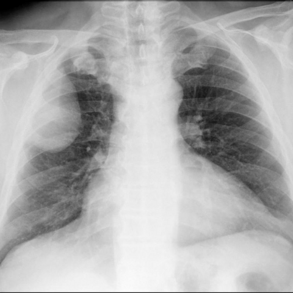
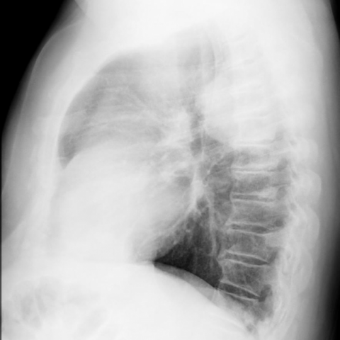

# Official gain: 11858_8353800664572

Post-run explicit answers: D **B**, M **B**, P **B**, reference **B**. Frozen runtime answers: D B, M None, P B; original records unchanged.

[Complete observable requests, tools and stages](../traces/11858_8353800664572.json) · [Original benchmark case](../../v12/results/cases/11858_8353800664572.md) · [D cached original observable request](../../direct_qwen60/requests/11858_8353800664572.json)

```text
Based on the chest X-ray findings and the clinical history, which of the following is the most likely diagnosis for the mass observed in the right hemithorax of this 57-year-old male patient?

A. Lipoma
B. Well-differentiated liposarcoma
C. Metastatic tumor
D. Pleural effusion
E. Primary lung cancer
F. Pneumonia
```





## D

```text
Answer: B. Well-differentiated liposarcoma  
Reason: The large, well-circumscribed, homogeneous mass in the right hemithorax with fat density (radiolucency) on chest X-ray—especially in a middle-aged male—is highly suggestive of a lipomatous tumor; well-differentiated liposarcoma is the most common malignant soft-tissue tumor in adults and can present as a large intrathoracic mass with fat attenuation, whereas benign lipoma is less likely to reach this size and location. The absence of air bronchograms and lack of infiltrative pattern argue against pneumonia or primary lung cancer; pleural effusion would show meniscus sign and layering, not a solid mass; metastasis is possible but less likely without known primary or multiple lesions.
```

## M

```text
The tool calls didn't provide the expected information. The report generator gave a generic report that doesn't match what I'm seeing in the image (it mentions "mild interstitial pulmonary edema" but doesn't acknowledge the large mass), and the phrase grounding couldn't locate a "Mass" finding.

Let me analyze the images directly with my own vision and reasoning:

From Figure 1a (frontal view), I can clearly see:
- A large, well-circumscribed, homogeneous opacity in the right hemithorax
- The mass is pushing the mediastinum to the left
- The lung appears compressed but not infiltrated by the mass
- The mass has smooth borders and appears extrapulmonary

From Figure 1b (lateral view), I can see:
- The mass is located posteriorly in the thorax
- It's well-defined with homogeneous density
- There's no evidence of lung infiltration

Key characteristics of this mass:
1. Large size
2. Well-circumscribed borders
3. Extrapulmonary location (displacing rather than infiltrating lung)
4. Homogeneous density
5. Posterior location

Now let's evaluate the differential diagnosis:

A. Lipoma - Benign fatty tumor, typically well-circumscribed, but usually smaller and less likely to cause significant mediastinal shift in a 57-year-old male without prior history.

B. Well-differentiated liposarcoma - This is a malignant soft tissue tumor that can present as a large, well-circumscribed mass in the thorax. Liposarcomas often occur in older adults (50-70 years) and can be large with homogeneous appearance on X-ray. They're more likely than lipomas to cause significant mass effect.

C. Metastatic tumor - Usually multiple lesions, though solitary metastases can occur. Less likely to be so well-circumscribed and homogeneous.

D. Pleural effusion - Would appear as a meniscus-shaped opacity with blunting of costophrenic angles, not a well-circumscribed mass.

E. Primary lung cancer - Typically shows infiltrative pattern within lung parenchyma, irregular borders, and may have cavitation or spiculation. This mass appears extrapulmonary.

F. Pneumonia - Would show air-space consolidation with air bronchograms, not a well-circumscribed mass.

Given the age (57), the large size, well-circumscribed nature, extrapulmonary location, and homogeneous appearance, a well-differentiated liposarcoma is the most likely diagnosis. Liposarcomas are the most common malignant soft tissue tumors in adults over 40, and well-differentiated types can present as large, slow-growing masses with benign-appearing radiographic features.

Return Answer: B. Well-differentiated liposarcoma - The large, well-circumscribed, homogeneous mass in the right hemithorax with extrapulmonary location and significant mass effect is characteristic of a well-differentiated liposarcoma in a middle-aged adult, which often presents with deceptively benign radiographic features despite being malignant.
```

## P

```text
Answer: B. Well-differentiated liposarcoma  
The mass shows internal radiolucency consistent with fat density and well-circumscribed margins on frontal view, and is extrapulmonary, abutting the chest wall without lung invasion on both frontal and lateral views. While lipoma (A) is also fat-containing and well-circumscribed, it is typically smaller and more common in subcutaneous tissue; a large, deep-seated, extrapleural fat-containing mass in a 57-year-old male favors well-differentiated liposarcoma over benign lipoma. Metastatic tumor (C), pleural effusion (D), primary lung cancer (E), and pneumonia (F) do not typically present with fat-density radiolucency or well-defined extrapulmonary margins.
```

