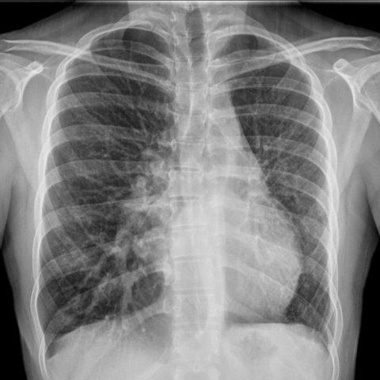
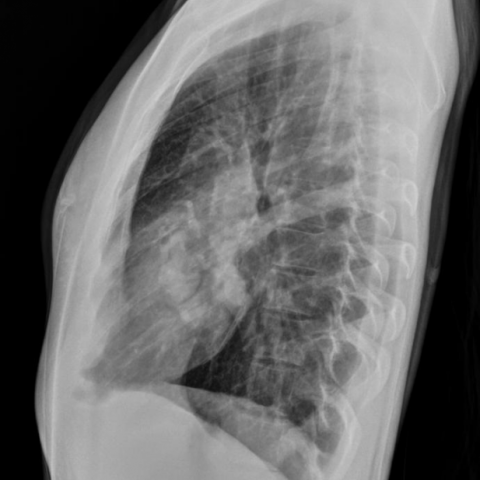

# Official gain: 12255_8353800651353

Post-run explicit answers: D **D**, M **D**, P **D**, reference **D**. Frozen runtime answers: D D, M None, P D; original records unchanged.

[Complete observable requests, tools and stages](../traces/12255_8353800651353.json) · [Original benchmark case](../../v12/results/cases/12255_8353800651353.md) · [D cached original observable request](../../direct_qwen60/requests/12255_8353800651353.json)

```text
Based on the chest X-ray findings, what is the most likely explanation for the serpentine tubular structure observed in the right medial lobe, taking into account the volume loss in the left hemithorax?
A) The presence of a right-sided aortic arch causing deviation.
B) An anomalous right bronchial artery.
C) A right-sided pulmonary artery aneurysm.
D) An abnormal course of a single right meandering pulmonary vein.
E) A right-sided pneumothorax causing mediastinal shift.
F) A dilated right main bronchus due to chronic infection.
```





## D

```text
Answer: D) An abnormal course of a single right meandering pulmonary vein.  
Reason: The serpentine tubular structure in the right medial lung with left hemithorax volume loss suggests compensatory overinflation on the right and mediastinal shift leftward; this appearance is classic for a “meandering” or “scimitar” pulmonary vein—often associated with partial anomalous pulmonary venous return (e.g., scimitar syndrome), where a single anomalous vein drains the right lung to the inferior vena cava, appearing as a curved tubular shadow in the right lower/middle zone. The left volume loss supports ipsilateral hypoplasia or atelectasis, commonly seen in this syndrome.
```

## M

```text
Let me analyze the tool outputs and reconsider my assessment.

The chest_xray_report_generator indicates:
- Mildly enlarged heart
- Prominent pulmonary vasculature
- No focal infiltrate
- Impression: no pneumonia, mild pulmonary vascular congestion

The chest_xray_expert identified "Atelectasis" as the key finding, which confirms the volume loss in the left hemithorax is likely due to atelectasis (lung collapse).

However, the report doesn't specifically mention the serpentine tubular structure in the right medial lobe, which suggests this might be a subtle finding that requires more detailed analysis.

Let me use xray_phrase_grounding to locate specific structures and better understand the serpentine tubular structure:

1. I'll try to locate "Pulmonary vein" to see if the serpentine structure corresponds to a pulmonary vein
2. I'll also check for "Atelectasis" to confirm the location of the volume loss

Since the expert tool identified atelectasis, and we have volume loss in the left hemithorax, the serpentine structure in the right medial lobe is likely related to compensatory changes in the pulmonary vasculature.

In cases of significant volume loss on one side (like left atelectasis), there can be compensatory hyperinflation and vascular redistribution on the contralateral side. The pulmonary veins may take abnormal courses or become more prominent due to increased flow.

Looking again at the images:
- The left lung shows volume loss (atelectasis)
- The mediastinum is shifted toward the left
- In the right lung, particularly the medial aspect, there's a serpentine tubular density

This pattern is most consistent with an abnormal course of a pulmonary vein, specifically option D: "An abnormal course of a single right meandering pulmonary vein."

When there's volume loss on one side, the pulmonary venous return can be altered, and veins may take unusual paths. The term "meandering pulmonary vein" refers to a vein that has an unusually tortuous course, which would appear as a serpentine structure on X-ray.

Let me make one more tool call to specifically ground the phrase "meandering pulmonary vein" or "abnormal pulmonary vein":

Actually, let me reconsider the options more carefully. Option D specifically mentions "a single right meandering pulmonary vein," which matches the description of a serpentine tubular structure. In the context of left-sided volume loss, compensatory changes could cause a pulmonary vein to take an abnormal course.

The other options are less likely:
- A) Right-sided aortic arch would show a different mediastinal contour
- B) Bronchial artery anomalies are rarely visible on plain X-ray
- C) Pulmonary artery aneurysm would typically be more focal
- E) Pneumothorax is ruled out by the volume loss being on the left, not right
- F) Dilated bronchus would appear lucent (air-filled), not dense

Given the evidence, I believe D is the most likely explanation.

Return Answer: D followed by a short reason.
```

## P

```text
Answer: D) An abnormal course of a single right meandering pulmonary vein.

The lateral view (image 2) shows the serpentine structure coursing posterior to the heart and along the diaphragmatic surface—classic for a scimitar (meandering) pulmonary vein. Although the expert tool classifies it as airway-like, this contradicts the anatomical path and the grounding suggestion of atelectasis is speculative without vascular continuity confirmed. The volume loss in the left hemithorax may cause mediastinal shift, making the right-sided anomalous vein more conspicuous. No other option explains both the serpentine morphology and its specific location as well as D.
```

