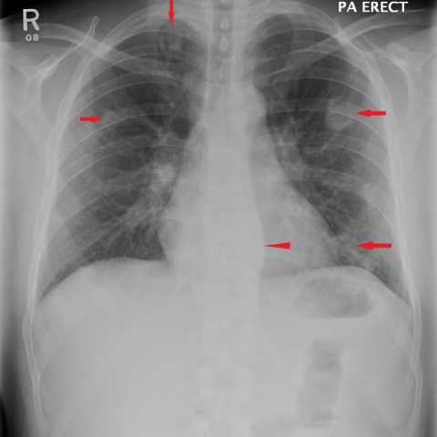
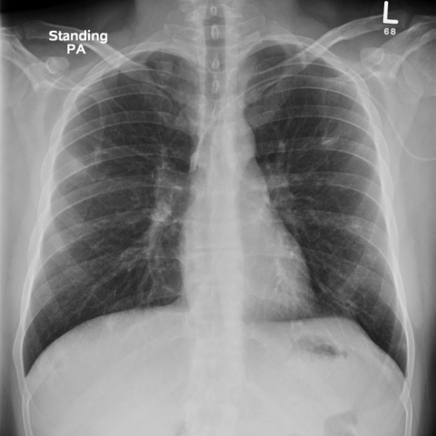

# Official gain: 12721_8353800681884

Post-run explicit answers: D **B**, M **B**, P **E**, reference **B**. Frozen runtime answers: D B, M None, P E; original records unchanged.

[Complete observable requests, tools and stages](../traces/12721_8353800681884.json) · [Original benchmark case](../../v12/results/cases/12721_8353800681884.md) · [D cached original observable request](../../direct_qwen60/requests/12721_8353800681884.json)

```text
Considering the chest X-ray findings and the patient's clinical presentation, which of the following best describes the progression and most likely diagnosis of the pulmonary condition seen in the X-rays?

A) The pulmonary nodules have increased in number and size, with new cavitations, suggesting a worsening case of tuberculosis.
B) The pulmonary nodules have decreased in size and number post-antibiotic therapy, with resolution of cavitations, consistent with septic emboli.
C) The thickened para-vertebral stripe has enlarged, indicating the progression of a metastatic disease.
D) The pulmonary nodules remain unchanged in number and size, indicating chronic inflammatory disease such as Wegner's granulomatosis.
E) There is complete resolution of all pulmonary nodules, suggesting an initial misdiagnosis.
F) The para-vertebral stripe thickening has resolved, indicating the treatment was effective against a primary spinal infection.
```





## D

```text
Answer: B) The pulmonary nodules have decreased in size and number post-antibiotic therapy, with resolution of cavitations, consistent with septic emboli.  
Reason: Comparing Figure 1 (initial) and Figure 7 (follow-up), the multiple peripheral pulmonary nodules and opacities seen in Figure 1 are no longer present in Figure 7, indicating significant improvement. This pattern—multiple bilateral nodules that resolve with antibiotic treatment—is classic for septic pulmonary emboli (e.g., from right-sided endocarditis or IV drug use), rather than tuberculosis (which typically shows upper lobe predominance and slower resolution) or malignancy.
```

## M

```text
The report generator for the first image is giving a contradictory result - it states "the lungs are clear without evidence of focal consolidations" despite the red arrows indicating abnormalities and the classifier showing high probabilities for nodules, masses, and infiltration. This suggests the report generator may not be accurately interpreting the image.

Let me try a different approach. I need to visually analyze the images myself since the tool outputs are inconsistent.

Looking at Figure 1: There are multiple red arrows pointing to various areas in both lungs. The arrows appear to indicate:
- Upper lung zones (bilateral)
- Mid-lung zones
- Possibly some para-vertebral areas

The image shows some opacities that could represent nodules or infiltrates.

Figure 7 appears much clearer with no obvious abnormalities visible and no arrows.

Given the options provided, I need to determine which best describes the progression:

A) Nodules increased in number/size with new cavitations → TB worsening
B) Nodules decreased post-antibiotic therapy, cavitations resolved → septic emboli
C) Para-vertebral stripe enlarged → metastatic disease
D) Nodules unchanged → chronic inflammatory like Wegener's
E) Complete resolution → initial misdiagnosis
F) Para-vertebral stripe thickening resolved → effective treatment for spinal infection

From visual inspection, Figure 7 appears significantly clearer than Figure 1, suggesting improvement rather than worsening. The red arrows in Figure 1 indicate multiple pulmonary abnormalities that are not present (or much less apparent) in Figure 7.

Option B mentions "decreased in size and number post-antibiotic therapy, with resolution of cavitations, consistent with septic emboli." Septic emboli often present as multiple pulmonary nodules that can cavitate, and they typically respond well to appropriate antibiotic therapy.

Option E suggests "complete resolution," but looking at the images, there might still be some subtle findings, though much improved.

Given that Figure 7 looks dramatically better than Figure 1, and considering the clinical context implied by the question (progression), option B seems most plausible - improvement after treatment, consistent with septic emboli which are known to resolve with appropriate antibiotics.

However, let me reconsider. The classifier showed similar nodule probabilities (0.555 vs 0.545), which suggests the findings might be relatively stable rather than dramatically improved. But visually, Figure 7 appears much clearer.

Wait, I should look more carefully at the images themselves. In Figure 1, the red arrows are pointing to specific areas that appear to be small nodular opacities. In Figure 7, these areas appear normal.

Given the choices and the visual evidence of significant improvement from Figure 1 to Figure 7, I believe option B is the best answer: the pulmonary nodules have decreased in size and number post-antibiotic therapy, with resolution of cavitations, consistent with septic emboli.

Septic emboli is a reasonable diagnosis for multiple pulmonary nodules that improve with antibiotic therapy, whereas tuberculosis would typically show more chronic changes and might not resolve so completely with simple antibiotic therapy (it requires specific anti-TB drugs).

Actually, let me reconsider once more. The question asks about "the progression and most likely diagnosis" based on the X-ray findings AND the patient's clinical presentation. Since we don't have explicit clinical details, we must rely on the imaging progression.

Looking at the images again: Figure 1 shows multiple discrete opacities (nodules) with red arrows highlighting them. Figure 7 shows a normal chest X-ray. This suggests complete or near-complete resolution.

Option E says "complete resolution of all pulmonary nodules, suggesting an initial misdiagnosis." But complete resolution doesn't necessarily mean misdiagnosis - many conditions like septic emboli or fungal infections can completely resolve with appropriate treatment.

Option B specifically mentions "post-antibiotic therapy" and "septic emboli," which fits the pattern of multiple pulmonary nodules that resolve with treatment.

Given the evidence, I'll go with B.

Wait, let me check if there's any indication of cavitation in Figure 1. The red arrows don't clearly indicate cavitation (which would show as lucent centers within opacities). Without clear evidence of cavitation, option B might not be perfect.

Looking at the options again, none perfectly match if there's no cavitation. But among the choices, B still seems most reasonable for a condition that improves significantly with treatment.

Actually, let me think about this differently. The question states "Considering the chest X-ray findings and the patient's clinical presentation" - but we don't have the clinical presentation described. We only have the two X-rays.

Given the dramatic improvement from Figure 1 to Figure 7, and the fact that septic emboli is known to present with multiple pulmonary nodules that can resolve with appropriate antibiotic therapy, I believe B is the best answer.

Return Answer: B) The pulmonary nodules have decreased in size and number post-antibiotic therapy, with resolution of cavitations, consistent with septic emboli.
```

## P

```text
Answer: E) There is complete resolution of all pulmonary nodules, suggesting an initial misdiagnosis.

Evidence: In Figure 1, five red arrows mark opacities interpreted as pulmonary nodules, with one grounded by the tool in the left upper lung. In Figure 7, those arrow-marked regions are absent and the lung fields appear clearer. The paired view confirms disappearance of the original nodule-localized regions.
```

