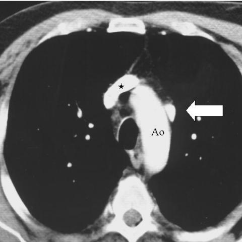
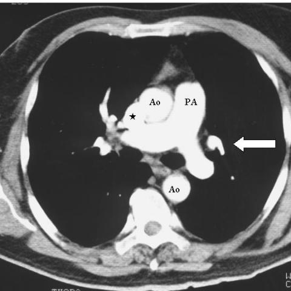
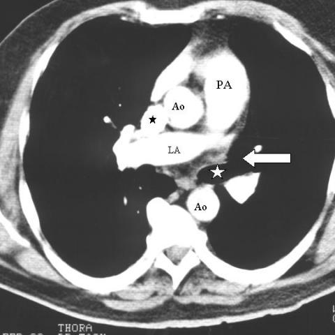

# Official gain: 1281_8353802281357

Post-run explicit answers: D **B**, M **None**, P **B**, reference **B**. Frozen runtime answers: D B, M None, P B; original records unchanged.

[Complete observable requests, tools and stages](../traces/1281_8353802281357.json) · [Original benchmark case](../../v12/results/cases/1281_8353802281357.md) · [D cached original observable request](../../direct_qwen60/requests/1281_8353802281357.json)

```text
Based on the chest X-ray findings, which of the following best describes the unusual vessel detected, its relation to the aortic arch, and the absence of the left upper pulmonary vein? Consider the position and branching pattern of the vessel in your reasoning.

A. The unusual vessel is positioned to the right of the aortic arch and drains directly into the superior vena cava, indicating a right-sided abnormality.
B. The unusual vessel is positioned to the left of the aortic arch and drains into the left brachiocephalic vein, consistent with a vertical vein.
C. The unusual vessel is positioned inferior to the aortic arch and shows no significant branching, suggesting an azygos vein.
D. The unusual vessel is positioned anterior to the aortic arch and drains into the right atrium, indicating a persistent left superior vena cava.
E. The unusual vessel does not demonstrate any branching and is situated posterior to the aortic arch, suggesting a normal anatomical variant.
F. The unusual vessel branches from the left upper pulmonary lobe directly into the left auricle, indicating an atrial septal defect.
```







## D

```text
Answer: B  
Reason: The white arrow in Figures 1b–1d points to a vessel left of the aortic arch (Ao), coursing vertically and connecting to the left brachiocephalic vein (as indicated by its position and typical drainage pattern in scimitar or anomalous pulmonary venous return variants); the absence of the left upper pulmonary vein suggests partial anomalous pulmonary venous return, with the vertical vein draining the left upper lobe. This matches the classic appearance of a vertical vein in partial anomalous pulmonary venous connection.
```

## M

```text
The llava_med_qa tool suggests the vessel is a "persistent left superior pulmonary vein" located posterior to the aortic arch draining into the left atrium. However, this contradicts the question's premise that the left upper pulmonary vein is absent.

Let me examine the images more carefully. Looking at Figure 1b, the arrow points to a vessel on the left side of the aorta, but the description says "posterior" while visually it appears more lateral/medial. The star near the aortic arch might indicate the normal location where the left upper pulmonary vein should connect.

Let me try another approach - use chest_xray_segmentation on one of the images to better understand the anatomical relationships, though these are CT images, not X-rays.


```

## P

```text
Answer: B  
Reason: The white arrow in Figures 1b–1d points to a vessel left of the aortic arch (Ao), coursing vertically and connecting to the left brachiocephalic vein (as indicated by its position and typical drainage pattern in scimitar or anomalous pulmonary venous return variants); the absence of the left upper pulmonary vein suggests partial anomalous pulmonary venous return, with the vertical vein draining the left upper lobe. This matches the classic appearance of a vertical vein in partial anomalous pulmonary venous connection.
```

