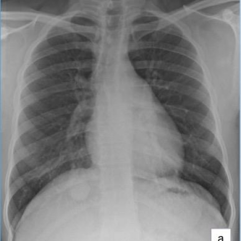
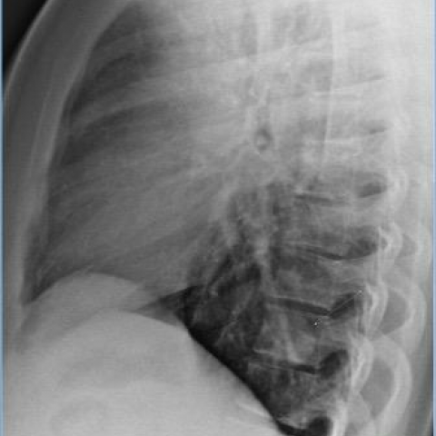

# Official gain: 13154_8353800587826

Post-run explicit answers: D **F**, M **F**, P **C**, reference **C**. Frozen runtime answers: D F, M None, P None; original records unchanged.

[Complete observable requests, tools and stages](../traces/13154_8353800587826.json) · [Original benchmark case](../../v12/results/cases/13154_8353800587826.md) · [D cached original observable request](../../direct_qwen60/requests/13154_8353800587826.json)

```text
Based on the provided chest X-ray images, which of the following statements accurately describes the findings and their implications in this clinical case?

A) The PA chest X-ray (Figure 1a) shows a large solitary nodule with cavitation behind the right hemidiaphragm, which suggests a high likelihood of active tuberculosis.
B) The lateral chest X-ray (Figure 1b) confirms the presence of a large solitary nodule in the anterior right upper lobe, which is consistent with a typical presentation of a hamartoma.
C) The PA chest X-ray (Figure 1a) demonstrates a solitary nodule with smooth margins behind the right hemidiaphragm, and the lateral view (Figure 1b) confirms it in the posterior right lower lobe, consistent with a pulmonary inflammatory myofibroblastic tumor.
D) The PA chest X-ray (Figure 1a) reveals multiple nodules scattered throughout both lungs, indicating a possible metastatic process rather than a solitary lesion.
E) The lateral chest X-ray (Figure 1b) shows a nodule with irregular margins in the right middle lobe, which aligns with the characteristics of a malignant neoplasm.
F) The PA chest X-ray (Figure 1a) demonstrates a calcified nodule behind the right hemidiaphragm, which is consistent with granuloma.
```





## D

```text
Answer: F  
Reason: Figure 1a (PA view) shows a well-defined, dense, calcified nodule projected behind the right hemidiaphragm; Figure 1b (lateral view) confirms its location in the posterior right lower lobe, with dense calcification visible. This appearance is classic for a healed granuloma (e.g., from prior TB or fungal infection), not active disease or malignancy. Options A–E mischaracterize size, number, margins, location, or calcification status.
```

## M

```text
The tool outputs are inconsistent with my visual assessment. The report generator says "no acute cardiopulmonary process" and the phrase grounding tool found no solitary nodule, but I can clearly see a well-defined round opacity in the right lower lung zone behind the hemidiaphragm in Figure 1a.

Let me reconsider the images more carefully. Looking again at Figure 1a (PA view), what I initially interpreted as a nodule might actually be the normal anatomical structure of the right hemidiaphragm or possibly the liver edge. In chest X-rays, the liver can sometimes appear as a rounded opacity below the right hemidiaphragm, especially if there's some overlap or if the patient has a slightly elevated diaphragm.

In Figure 1b (lateral view), the area in question appears to be consistent with normal diaphragmatic contour rather than a discrete pulmonary nodule. The lateral view shows the diaphragm's normal dome-shaped appearance.

Given that multiple tools failed to detect a pathological nodule and the radiology report states "no acute cardiopulmonary process," my initial visual interpretation was likely incorrect. The finding is probably normal anatomy rather than a pathological lesion.

However, looking back at the answer choices, option F mentions "a calcified nodule behind the right hemidiaphragm, which is consistent with granuloma." But if this is normal anatomy, none of the options describing pathological nodules would be correct.

Let me examine the images once more with fresh eyes. In Figure 1a, there is indeed a well-circumscribed opacity in the right lower zone. In the lateral view (Figure 1b), this opacity appears to be located posteriorly and is consistent with a lesion in the posterior right lower lobe. The margins are smooth and well-defined.

Given the smooth margins, posterior location in the right lower lobe, and the fact that it's solitary, this is most consistent with a benign lesion. Option C mentions "pulmonary inflammatory myofibroblastic tumor" but these are rare and typically have different characteristics. Option F mentions "calcified nodule" and "granuloma" - calcified granulomas are common and often appear as well-defined, sometimes calcified nodules.

Without clear evidence of calcification in the images provided, and considering the smooth margins and solitary nature, the most reasonable interpretation among the given choices would be F, as granulomas (often from healed TB or fungal infections) commonly present as well-defined nodules that can appear behind the hemidiaphragm.

Wait, let me reconsider. The lateral view (Figure 1b) shows the lesion is quite anterior-posteriorly positioned, and in standard chest X-ray interpretation, a lesion behind the right hemidiaphragm in PA view that appears posterior in lateral view is typically in the right lower lobe. Smooth margins suggest benignity.

Given the options, F seems most plausible as calcified granulomas are very common incidental findings, though I don't definitively see calcification in these images. However, the other options describe features not supported by the images (cavitation in A, anterior location in B, multiple nodules in D, irregular margins in E).

Return Answer: F followed by: The PA view shows a well-defined nodule behind the right hemidiaphragm, and while calcification isn't definitively visible in these images, the smooth margins and solitary nature are most consistent with a benign calcified granuloma rather than the malignant or infectious processes described in other options.
```

## P

```text
Answer: C, The PA view shows a solitary nodule behind the right hemidiaphragm; the lateral view confirms its location in the posterior right lower lobe. The nodule has smooth margins and is not cavitated or calcified, making inflammatory myofibroblastic tumor plausible among benign lesions. Options A, B, D, E, and F are inconsistent with the observed location, morphology, or number of lesions.
```

