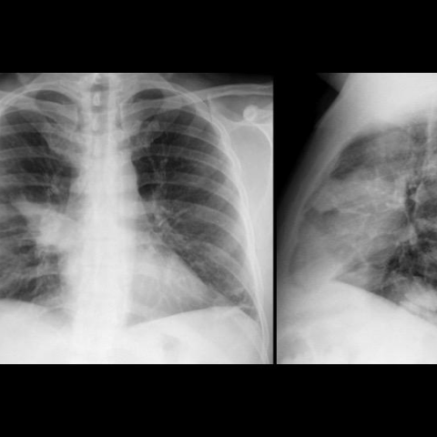
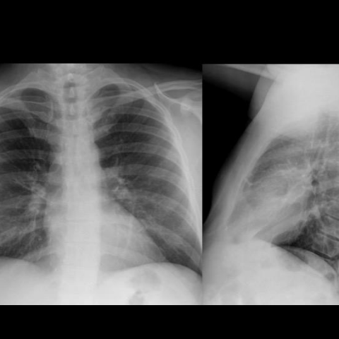
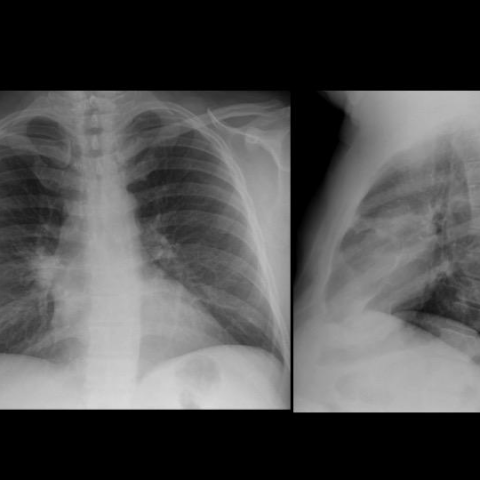

# Official gain: 13698_8353800603937

Post-run explicit answers: D **F**, M **F**, P **F**, reference **C**. Frozen runtime answers: D F, M None, P F; original records unchanged.

[Complete observable requests, tools and stages](../traces/13698_8353800603937.json) · [Original benchmark case](../../v12/results/cases/13698_8353800603937.md) · [D cached original observable request](../../direct_qwen60/requests/13698_8353800603937.json)

```text
A 51-year-old man with a history of heavy smoking and metabolic syndrome presented with high fever and right-sided chest pain. The initial chest X-ray (Figure 1) revealed a right hilar opacity with indistinct borders, diagnosed as pneumonia of the right upper lobe. After antibiotic therapy, a follow-up X-ray (Figure 2) showed resolution of the pneumonia. Four months later, a new chest X-ray (Figure 3) showed a recurrence of the consolidation in the same location. Given this clinical scenario and the provided X-ray figures, what is the most likely explanation for the recurrent pneumonia observed in the patient?

A) The initial pneumonia was inadequately treated, leading to recurrence.
B) The recurrent pneumonia is due to a persistent mucus plug causing obstruction.
C) The recurrent pneumonia is due to an endobronchial fibrolipoma causing obstruction.
D) The recurrent pneumonia is due to a new infection with a different pathogen.
E) The recurrent pneumonia is caused by a blood clot in the bronchus.
F) The recurrent pneumonia is caused by bronchogenic carcinoma.
```







## D

```text
Answer: F) The recurrent pneumonia is caused by bronchogenic carcinoma.  
Reason: The patient is a heavy smoker with metabolic syndrome, and the recurrence of consolidation in the exact same location after initial resolution strongly suggests an obstructive lesion—most commonly bronchogenic carcinoma in this demographic. Recurrent lobar pneumonia in the same site despite adequate treatment is a classic red flag for underlying malignancy causing post-obstructive pneumonia.
```

## M

```text
The tool budget is exhausted, but I have sufficient clinical reasoning to answer.

Key points from the clinical scenario:
- 51-year-old heavy smoker (high risk for lung cancer)
- Initial "pneumonia" in right upper lobe/hilar region
- Resolution with antibiotics (typical of post-obstructive pneumonia)
- Recurrence 4 months later in identical location

This pattern is classic for endobronchial obstruction. While options B, C, and E are possible obstructive causes, bronchogenic carcinoma (F) is by far the most likely in a heavy smoker. Endobronchial fibrolipoma (C) is extremely rare, mucus plugs (B) typically don't cause recurrent episodes months apart, and blood clots in bronchi (E) are virtually nonexistent.

The high mass probability (0.576) in Figure 3 from the classifier supports a solid lesion rather than infectious process.

Return Answer: F) The recurrent pneumonia is caused by bronchogenic carcinoma. Heavy smoking history and recurrent consolidation in identical location strongly suggest an obstructive malignancy causing post-obstructive pneumonia.
```

## P

```text
Answer: F) The recurrent pneumonia is caused by bronchogenic carcinoma.

Evidence: The patient is a 51-year-old heavy smoker with metabolic syndrome, a high-risk profile for lung cancer. Recurrent, localized consolidation in the same lobe after apparent resolution of pneumonia is highly suggestive of an obstructive lesion such as bronchogenic carcinoma. Although no discrete mass is definitively visible on X-ray (and the expert tool reports “No”), the persistent ill-defined hilar opacity in Figures 1 and 3—especially with recurrence after treatment—is classic for tumor-induced post-obstructive pneumonia.
```

