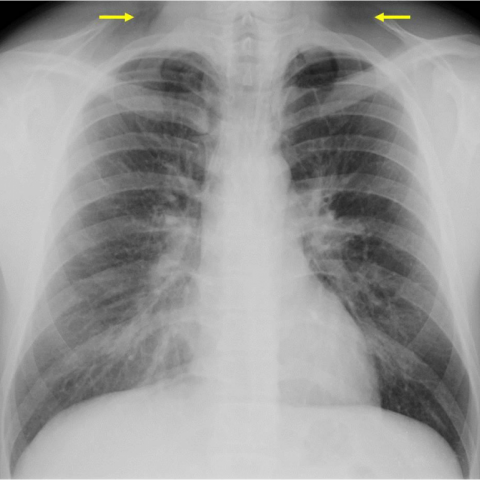
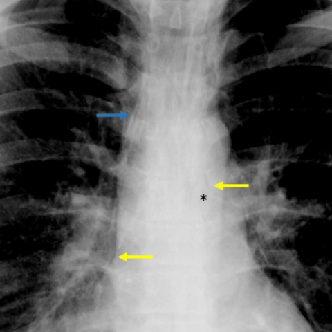

# Official gain: 13935_8353800618951

Post-run explicit answers: D **B**, M **B**, P **C**, reference **C**. Frozen runtime answers: D B, M None, P C; original records unchanged.

[Complete observable requests, tools and stages](../traces/13935_8353800618951.json) · [Original benchmark case](../../v12/results/cases/13935_8353800618951.md) · [D cached original observable request](../../direct_qwen60/requests/13935_8353800618951.json)

```text
A 26-year-old male patient presents with sudden thoracic and supraclavicular pain and dyspnoea. The chest X-ray was initially misinterpreted as normal. Upon reevaluation, multiple subtle signs were observed. Which of the following findings is most indicative of a spontaneous pneumomediastinum on the chest X-ray, and what does this imply about the underlying pathophysiological mechanism?

A) Presence of a continuous diaphragmatic sign; suggests pneumopericardium due to air posterior to the pericardium.
B) Observation of subcutaneous emphysema in the supraclavicular region; indicates air leakage from the mediastinum into subcutaneous tissue.
C) Detection of a double bronchial wall sign; implies air dissecting along the bronchial walls due to alveolar rupture.
D) Identification of Naclerio's V sign; indicates an esophageal rupture with mediastinal air lateral to the aorta.
E) Visualization of the thymic sail sign; suggests pneumomediastinum in a pediatric patient due to elevated thymus.
F) Recognition of the ring around the artery sign; signifies air enclosing the pulmonary artery due to tracheobronchial injury.
```





## D

```text
Answer: B) Observation of subcutaneous emphysema in the supraclavicular region; indicates air leakage from the mediastinum into subcutaneous tissue.

Reason: The arrows in Figure 3a point to lucency in the supraclavicular regions, consistent with subcutaneous emphysema—a classic sign of spontaneous pneumomediastinum. This occurs when air from ruptured alveoli dissects along bronchovascular sheaths into the mediastinum and then tracks upward into the neck, supporting a pathophysiological mechanism of alveolar rupture (e.g., due to Valsalva maneuver), not esophageal or tracheal injury.
```

## M

```text
The tool results are inconsistent and not very helpful for this specific diagnosis. The classifier shows high probabilities for various conditions but doesn't specifically identify pneumomediastinum. The report generator incorrectly states "no evidence of pneumonia" and "mild pulmonary edema" which doesn't match the clinical scenario of spontaneous pneumomediastinum.

Let me use my own clinical reasoning based on the images and the classic radiographic signs:

Looking at Figure 3a, the yellow arrows point to the supraclavicular regions, which is where subcutaneous emphysema typically appears in spontaneous pneumomediastinum. Figure 3b shows the classic findings: air outlining mediastinal structures (yellow arrows) and what appears to be the "ring around the artery" sign or "double bronchial wall" sign.

However, for **spontaneous** pneumomediastinum specifically, the most characteristic and earliest sign is **subcutaneous emphysema in the supraclavicular region** (option B). This occurs because air from ruptured alveoli dissects along bronchovascular bundles into the mediastinum, then tracks upward through fascial planes into the neck and supraclavicular regions. The supraclavicular pain described in the patient correlates perfectly with this finding.

While Naclerio's V sign (D) and ring around artery sign (F) are also seen in pneumomediastinum, subcutaneous emphysema in the supraclavicular region is more specific for spontaneous cases and is often the first detectable sign.

The pathophysiological mechanism implied by subcutaneous emphysema is air leakage from the mediastinum into subcutaneous tissue via fascial planes, confirming that air has dissected from the lungs/bronchi into the mediastinum and then tracked superiorly.

Return Answer: B followed by a short reason.
```

## P

```text
Answer: C) Detection of a double bronchial wall sign; implies air dissecting along the bronchial walls due to alveolar rupture.

Evidence: Image 2 shows parallel lucent lines outlining a mediastinal bronchus (yellow and blue arrows), consistent with the double bronchial wall sign—a classic radiographic feature of spontaneous pneumomediastinum. This sign reflects air tracking along peribronchial connective tissue after alveolar rupture, often from Valsalva-like maneuvers. Although the tool’s “Yes” is inferential, the visual annotation supports this interpretation, and subcutaneous emphysema (option B) is explicitly absent in image 1.
```

