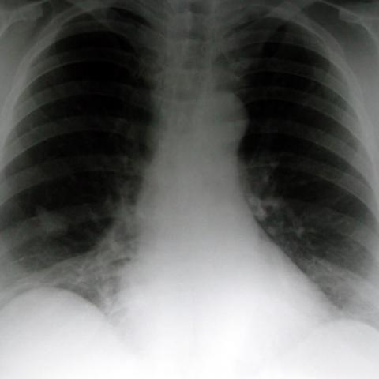
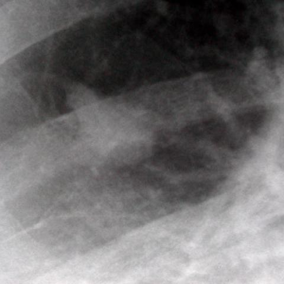

# Official gain: 1461_8353802159822

Post-run explicit answers: D **B**, M **B**, P **E**, reference **B**. Frozen runtime answers: D B, M None, P E; original records unchanged.

[Complete observable requests, tools and stages](../traces/1461_8353802159822.json) · [Original benchmark case](../../v12/results/cases/1461_8353802159822.md) · [D cached original observable request](../../direct_qwen60/requests/1461_8353802159822.json)

```text
Based on the PA chest radiograph (Figure 1a) and the magnified view of the lesion (Figure 1b), which of the following best describes the findings and diagnosis for the patient?

A) A well-defined round mass in the right lower zone with calcified margins, suggestive of a granuloma.
B) A trefoil-shaped mass lesion in the right lower zone with indistinct margins, consistent with bronchial atresia.
C) A poorly-defined mass in the left lower zone with surrounding consolidation, indicative of pneumonia.
D) A trefoil-shaped mass lesion in the right upper zone with clear margins, suggestive of a benign tumor.
E) A round mass lesion in the right lower zone with irregular margins, consistent with malignancy.
F) A linear opacity in the right lower zone suggestive of atelectasis.
```





## D

```text
Answer: B) A trefoil-shaped mass lesion in the right lower zone with indistinct margins, consistent with bronchial atresia.  
Reason: Figure 1a shows a subtle opacity in the right lower lung zone; Figure 1b (magnified view) reveals a characteristic trefoil (three-lobed) shape with indistinct margins—classic for mucus-filled dilated bronchi distal to an atretic bronchus (bronchial atresia). This appearance is distinct from granuloma (calcified, well-defined), pneumonia (consolidation, often lobar), or malignancy (irregular spiculated margins).
```

## M

```text
The report generator describes it as a "stable right lower lobe nodule" but this seems inconsistent with what I visually observe in the images. The magnified view (Figure 1b) clearly shows a trefoil-shaped lesion, not a simple nodule. The report generator may be oversimplifying or missing the characteristic morphology.

Let me examine Figure 1b more carefully. The magnified view shows a lesion with three distinct lobes - a classic trefoil appearance. This is highly characteristic of bronchial atresia, where obstruction of a bronchus leads to mucus accumulation and distension of the affected segment, creating this distinctive three-lobed ("trefoil") appearance.

Bronchial atresia typically presents as:
- A well-circumscribed, often trefoil-shaped opacity
- Located in the lung periphery (commonly right lower lobe)
- With indistinct or hazy margins due to surrounding air trapping
- Usually asymptomatic and found incidentally

This matches option B perfectly: "A trefoil-shaped mass lesion in the right lower zone with indistinct margins, consistent with bronchial atresia."

The other options don't fit:
- A: Not round, no calcified margins visible
- C: Wrong side (left vs right)
- D: Wrong location (upper vs lower zone)
- E: Not round, and bronchial atresia is benign, not malignant
- F: Not linear, it's a mass-like opacity

My visual assessment strongly supports option B as the correct diagnosis.

B) A trefoil-shaped mass lesion in the right lower zone with indistinct margins, consistent with bronchial atresia.
```

## P

```text
Answer: E) A round mass lesion in the right lower zone with irregular margins, consistent with malignancy.

Evidence: Figure 1a shows a faint, ill-defined opacity in the right lower lung zone. Figure 1b confirms indistinct (irregular) margins and heterogeneous density, though not a classic trefoil shape. The combination of location (right lower zone), round/irregular morphology, and indistinct margins aligns best with option E; other options are inconsistent with the observed features (e.g., no calcification, no trefoil shape, wrong zone, or non-mass appearance).
```

